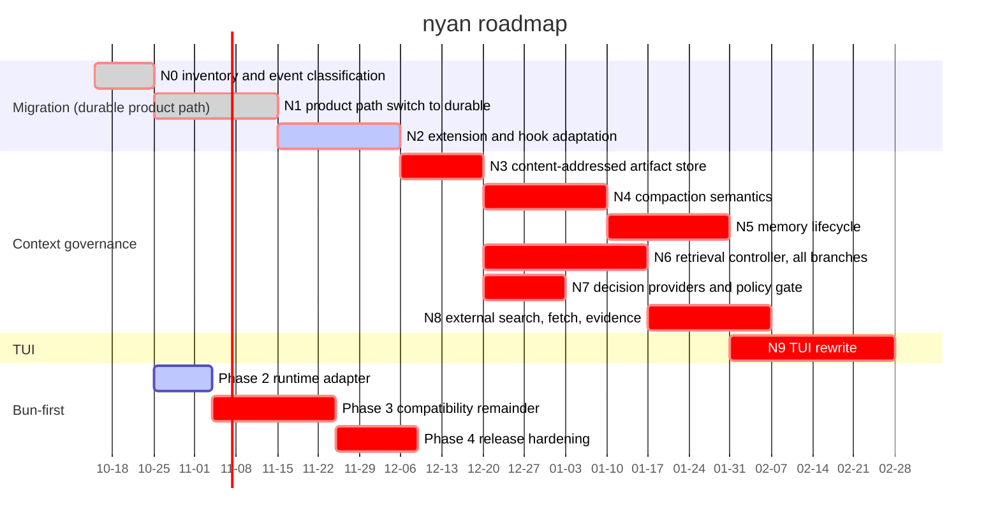

# Roadmap

Planned work and its status. Updated in the PR that changes it.

Last updated: 2026-10-16

WIP rule: No more than two roadmap lines may be active simultaneously.

This roadmap is the single source of truth for planned work and status. Future dates are estimates, not delivery commitments. A task is not considered done merely because source code, a design, or an external Pactile asset exists; its status requires verified Nyan repository or GitHub evidence. Owner recommendations below are planning assumptions, not owner decisions.

## Timeline

The Queue table records complete multi-parent dependencies where the compact Gantt representation uses one primary predecessor. Critical bars identify work waiting on an owner decision or on a task blocked by one. GitHub's current Mermaid renderer keeps the today marker on by default but rejects an explicit `todayMarker on` directive and its style form for this chart; the valid chart therefore relies on that default.

The verified baseline is `origin/main` at `589be2d73` after the N0 inventory and durable-path classification commits. The Nyan tree has 12 packages and has no `packages/context`, `packages/retrieval`, `packages/decision`, or `packages/coding-agent/src/core/context-governance` implementation. Pactile's source, tests, design documents, evidence fixtures, and the external retrieval worker are available as migration inputs, not as Nyan completion evidence. The 1.3.0 Herdr, Bun, and provider fixes are published; they do not implement Context Governance. On 2026-10-15 the owner fixed the target architecture for compression, memory, retrieval, decision, egress, and the terminal UI, and selected the implementation shape; those decisions are recorded in the [Decided architecture](#decided-architecture-2026-10-15), [Implementation orchestration](#implementation-orchestration-2026-10-15), and [TUI rewrite](#tui-rewrite) sections below. They are planning records, not implementation evidence. N2 and Bun Phase 2 are now the two active implementation lines.

### Status key

| Status | Meaning |
| --- | --- |
| Done | Implemented or formally published in Nyan and supported by repository or GitHub evidence |
| Active | Implementation is currently in progress and has a defined gate |
| Partial | A related Nyan slice exists, but the requested item is not complete |
| Queued | No Nyan implementation has started; it is scheduled in the Queue |
| Blocked | Queued work cannot cross an owner decision, permission, evidence, or readiness gate |
| Reference | Design, source, test, or evaluation material exists outside Nyan and still needs a governed port |
| Out of scope | Explicitly excluded from this roadmap |

### Item assessment

The following assessment covers every numbered item from the handoff. A source file, test, design note, or successful probe in Pactile is not counted as a Nyan implementation.

#### Bun-first assessment

| Item | Status | Judgement and destination |
| --- | --- | --- |
| Phase 1 CI and parity | Done | PR #10 added seven-package Bun CI; PRs #12, #13, and #14 covered the remaining package and HTTP differences. |
| Phase 2 runtime adapter | Active | The first batch freezes a pure runtime identity contract and begins HTTP/non-HTTP consumer convergence. The implemented boundary is recorded in [the parallelization note](.agents/notes/implemented/architecture/2026-10-16-bun-runtime-adapter-parallelization.md); full Phase 2 remains incomplete. |
| Phase 3 HTTP, WebSocket, SQLite, subprocess, and worker work | Partial | Bun native fetch and idle-timeout behavior are implemented by PR #13, and WebSocket-related parity fixes are merged. A unified adapter, SQLite evaluation, source-loader, subprocess, worker, and complete cross-runtime validation remain. Queue as Bun Phase 3. |
| Phase 4 size, startup, signing, and install guidance | Partial | Standalone Bun binaries are released by PR #7 and release attestation is present through PR #15. Size/startup benchmarks, signing certificate scope, and provider-independent install documentation remain. Queue as Bun Phase 4. |

#### Compression and context pipeline assessment

| Item | Status | Judgement and destination |
| --- | --- | --- |
| C1 | Queued | Port Pactile's pure ContextSnapshot, ContextDelta, validated cut-point, source-basis hash, and stale-validation contracts into durable's generic Context Governance runtime in N4. Keep the contracts independent of coding-agent while making durable the Nyan operation runtime. |
| C2 | Queued | Port the Context Surgery decision (`continue`, `mask`, `compact`, `blocked`), protected regions, and mask candidates. Masking is allowed only after payload externalization is verified; implement the policy in N4 and connect storage in N3. |
| C3 | Queued | Make durable's ContextOperation the Context Pipeline: The durable compaction task runs hooks and provider work, revalidates the basis, and commits only against an unchanged conversation; the coding-agent layer supplies product configuration. Implement across N1, N2, and N4; do not add a Host or a second agent loop. |
| C4 | Partial | Nyan already has LLM summaries, split-turn summaries, file-operation details, thinking omission, and summary failure checks. Add Pactile's structured checkpoint/fact boundaries, source binding, and fail-closed validation in N4 and B8; existing summary code is not completion evidence. |
| C5 | Queued | No governed Nyan context pipeline exists. Make the durable compaction task the lifecycle owner and durable storage the transcript owner in N4. |
| C6 | Queued | Replace the single threshold decision with Pactile's admission policy: continue below threshold, mask eligible externalized payloads first, compact only when required, and block when prerequisites or assurance are missing. Implement in N4. |
| C7 | Blocked | Review interaction and `/context review` are product-shape decisions. Do not create Pactile's App review UI or an approval chain until the owner decides whether Nyan should gate actions. |
| C8 | Blocked | Immutable approval grants are not a compression prerequisite for the current TUI design. Keep the contract visible, but defer implementation until the approval/product decision in N4. |
| C9 | Queued | Port CDR/CAR and snapshot/receipt validation as pure checks in N4; verify their real use on the durable path in N4. A receipt or assurance field alone is not evidence. |
| C10 | Queued | Make durable the owner of receipt creation, persistence, checkpoints, and recovery in N3 and N4, verified against the durability of the compaction task. |
| C11 | Queued | Add artifact intents, content-addressed artifacts, memory facts, disclosure metadata, and incomplete-operation recovery through durable in N3 and N4. A tool result cannot be masked merely because its tool appears rerunnable. |
| C12 | Queued | Port the post-compaction audit and fail-closed outcomes in N4: provider failure, summary truncation, stale basis, artifact loss, append failure, and reload mismatch must leave live context unchanged or explicitly blocked. |
| C13 | Queued | Port ContextUnitManifest, anchors, protected-region rules, and source fingerprints in N4. Bind them to durable conversations and entries rather than Pactile workspace/worktree admission. |
| C14 | Queued | Port the reversible context actions in N4. Lossy compression, masking without recoverable artifacts, and permanent drop remain separately authorized and are not silently enabled by the compression controller. |
| G1 | Queued | No governed context coordinator is attached to the agent loop. Implement as a durable task in N4. |
| G2 | Queued | No ContextUnitizer exists for transcript, retrieval pack, or artifact inputs. Implement in N4. |
| G3 | Queued | No Compression Controller exists. Implement the Pactile decision and commit pipeline on the durable compaction task in N4; it must be authoritative for context changes, not proposal-only. |
| G4 | Queued | No deterministic allow, deny, or review gate exists. Implement in N4. |
| G5 | Queued | Recovery, expansion, blocking, supersession, and regression cases are absent. Implement in N4. |
| G7 | Queued | No isolated evaluation controller exists. Implement in N4 without writing product state. |

#### Memory, host, and agent seam assessment

| Item | Status | Judgement and destination |
| --- | --- | --- |
| M1 | Queued | Fact schema, safety scanning, durability, recovery, and authorization are only in Pactile. Port and split in N4 and B3. |
| M2 | Queued | The Pactile ArtifactStore is not integrated in Nyan. Port its contract into durable's Context Governance runtime in N4 and implement the durable-owned artifact store in N3. |
| M3 | Queued | Nyan scope must use git root or cwd rather than Pactile workspace scope. Decide the cross-session location before N5. |
| M4 | Queued | No Nyan `memory_read` ToolDefinition or renderer exists. Implement in N2. |
| M5 | Queued | Durable-owned memory ports are not integrated in Nyan and have no coding-agent session/scope port. Implement in N3 and B3. |
| M6 | Blocked | Memory promotion is not implemented and requires the approval carrier in Owner Decision #11. Queue in N5. |
| M7 | Queued | No `/memory` view and delete flow exists. Implement in N5. |
| G8 | Blocked | Retention and cleanup policy was open in Pactile and still has no Nyan policy. Decide and implement in N5. |
| H1 | Queued | No Nyan ContextOperation ledger is integrated yet. Durable is the selected owner; implement the product-side integration and recovery checks in N1 through N4. |
| H2 | Queued | Durable tool effect intents and receipts are not integrated in coding-agent. Implement in N3 and bind them to the compaction task in N4. |
| H3 | Queued | No durable-backed ContextOperation RuntimeStore is integrated into coding-agent yet. Implement and verify it in N3; do not add a parallel coding-agent SQLite authority. |
| H4 | Queued | No durable-owned content-addressed ArtifactStore is integrated in Nyan. Implement it in N3 and expose it through the ContextOperation runtime. |
| H5 | Queued | Pactile path, case-fold, and NFC utilities are not in Nyan. Reconcile with existing path utilities in N4 and B2. |
| H6 | Queued | No governed run-session composition root exists in the product path. Compose it on the durable Harness in N1. |
| H7 | Queued | No governed checkpoint entry exists in Nyan JSONL sessions. Implement in N2. |
| H8 | Queued | Pactile validation and fingerprint helpers are not in Nyan. Port to N4. |
| Kernel settlement projector | Out of scope | Product Kernel and settlement projection are not part of the requested Nyan roadmap. |
| P1 | Queued | `context_update` is not in the Nyan agent package. Add it only with the required ownership note in N2. |
| P2 | Queued | The undefined tool-result field omission is not verified in Nyan. Add the narrow agent-core seam in N2. |
| P3 | Queued | Pactile's native-agent wrapper must not be copied as an adapter. Attach the needed lifecycle hooks directly to the durable Harness in N2. |
| P4 | Out of scope | Pactile provider-port and Pi adapter layers are unnecessary because Nyan already owns `@ny4n/ai`. |

#### Retrieval and decision-provider assessment

| Item | Status | Judgement and destination |
| --- | --- | --- |
| R1 | Reference | The zero-dependency worker exists only in `D:\MyHarness\pactile`; it is not an Nyan package. Port after the layer decision in N6. |
| R2 | Reference | Worker tests exist externally and are not Nyan evidence. Port selected parity tests in N6. |
| R3 | Reference | Retrieval ABI V3 files exist only in Pactile. Port contracts and planner in N6. |
| R4 | Queued | No Nyan local-worker process adapter exists. Implement Node and Bun paths in N6. |
| R5 | Queued | No Nyan agent retrieval boundary exists. Implement in N6. |
| R6 | Queued | No Nyan retrieval router, ranking, classification, or telemetry integration exists. Implement in N6. |
| R7 | Queued | `code_search` is not a Nyan tool. Implement in N6. |
| R8 | Queued | The semantic branch is an optional, self-hosted remote EmbeddingProvider rather than a fixed EmbeddingGemma implementation. The proposed profile is TEI `jinaai/jina-code-embeddings-1.5b` with client batch limit 32 and target 256 dimensions, but model revision, effective dimensions, normalization, prompt/task profile, precision, batch limit, and response shape must pass readiness checks before use. Provider output remains advisory and degrades to exact/structural retrieval. Implement in N6 and verify the provider profile and refusal matrix before claiming readiness. |
| R9 | Queued | Remote index writes use a self-hosted server-side index coordinator over Qdrant and a strict Tantivy/BM25 service. The coordinator owns staged immutable generations, active-manifest CAS, coordinator epoch/fencing, job leases/checkpoints, reconciliation, rollback, and retention; Nyan never mounts or mutates remote index files. Implement the client protocol and recovery fixtures in N6. |
| R10 | Queued | External Search, Fetch, and Evidence have design material but no Nyan implementation. Implement in N8. |
| R11 | Queued | No Retrieval Controller with branch budgets, deadlines, cancellation, or remote bootstrap ownership exists. Implement the controller in N6 with an idempotent server job protocol: a missing active generation starts a background bootstrap while core exact/structural retrieval returns immediately; stale-generation rebuilds remain independent operations. |
| R12 | Queued | Lexical and relation branches are not in Nyan. Implement deterministic branches in N6. |
| R13 | Queued | Canonical locators, source snapshots, file hashes, generation fences, merged IDs, staged Qdrant/Tantivy generations, and explicit RRF ordering are not in Nyan. Implement them in N6; every candidate must be re-read and checked against the current local source before entering the RetrievalPack. |
| R14 | Queued | Coverage, abstain, insufficient coverage, degraded, blocked, index-building, provider-unavailable, stale-source, and generation-mismatch states are not in Nyan. Implement explicit provider-combination degradation and keep the last active generation serving while bootstrap or incremental sync is building. |
| R15 | Queued | Retrieval capability and egress gates are not in Nyan. Configuring a provider is the authorization, so admission is automatic with the fixed safety constraints; implement the capability snapshot and gates in N7 and N8. |
| R16 | Queued | No Search Provider is configured or built into Nyan. The provider and key remain owner-supplied; implement the adapter and its readiness checks in N8. |
| R17 | Queued | No SSRF-safe Fetch adapter exists in Nyan. Implement host allowlists, HTTPS, redirects, limits, cancellation, and Artifact storage in N8. |
| R18 | Queued | No response-hash-based EvidenceRecord or citation pointer exists. Implement in N8. |
| R19 | Queued | No `web_search` or `web_fetch` tool exists. Implement in N8, after the evidence and citation rules exist. |
| R20 | Queued | Retrieval is not attached to Context Operation epochs, restart recovery, or the client/server source-snapshot contract. Integrate the recoverable RetrievalPack task in N2, B5, B7, and N6; durable converts validated packs to bounded ContextUnits and retrieval never writes Agent state directly. |
| R21 | Queued | No external-link security fixture suite exists in Nyan. Implement in N8. |
| G6 | Queued | Inspect, freshness, source-snapshot, file-hash, generation, scope, revision, coordinator fencing, manifest CAS, and hash fencing are not in Nyan. Implement in N6 with crash/reconciliation, duplicate-job, stale-source, and partial-index fault coverage. |
| J1 | Queued | Jev transport and outbound validation are not in Nyan; the Pactile hard-coded endpoint cannot be copied. The decision provider is a configured capability, so implement the contract and configuration in N7 without a fixed endpoint. |
| J2 | Queued | Rule provider and registry fallback are not in Nyan. Implement in N7. |
| J3 | Queued | Provider policy caps, assurance, and readiness are not in Nyan. Implement in N7. |
| J4 | Queued | The two Pactile Jev clients are not in Nyan and must be consolidated into one client. Implement in N7. |
| J5 | Queued | Retrieval and compression shadow suggestions are not implemented. `shadow` is a per-run branch mode rather than a later phase, so implement suggestion adoption and its receipts in N7 and N4. |
| J6 | Out of scope | Kernel scheduler, tile, task, and verification Jev integrations are excluded; only retrieval planning remains relevant. |

#### Test, evaluation, and evidence assessment

| Item | Status | Judgement and destination |
| --- | --- | --- |
| T1 | Reference | Pactile contract and durability tests exist externally. Port deterministic contract coverage to N4. |
| T2 | Reference | Pactile agent integration tests exist externally. Port applicable tests to N2 and B8. |
| T3 | Reference | Pactile runtime tests exist externally. Port host and recovery coverage to N3, B3, and B4. |
| T4 | Reference | Pactile retrieval tests exist externally. Port worker, planner, pack, and adapter coverage to N6. |
| T5 | Reference | Pactile Jev and provider-probe tests exist externally. Port safe readiness and schema tests to N7. |
| T6 | Out of scope | Kernel, old Pi executor/RPC host, and settlement-outbox tests are excluded. |
| E1 | Reference | P1a fixtures and frozen receipts exist in Pactile but are not in Nyan. Port as evaluation-only fixtures in N4; do not copy internal addresses. |
| E2 | Reference | P0 fixtures and review records exist in Pactile but are not Nyan product evidence. Port only the agreed evaluation assets in N4. |
| E3 | Blocked | The readiness probe exists but contains a tailnet address and cannot enter Nyan. Rewrite as configuration-only readiness checks after Owner Decision #4. |
| E4 | Blocked | The stage 1a runner was not found in the inspected sources. Owner Decision #5 is required before claiming runner parity. |
| E5 | Queued | Paired runs, FI-01 to FI-27, crash, replay, and unknown-outcome tests are new Nyan work in N4 through B9. |

#### Design and reference assessment

| Item | Status | Judgement and destination |
| --- | --- | --- |
| D1 | Reference | Compression decision chain and audit design; rewrite as an English Nyan spec for N4, B4, and B8. |
| D2 | Reference | ContextUnitManifest and protection rules; rewrite for N4. |
| D3 | Reference | Compression and memory evaluation matrix; use as N4 acceptance criteria. |
| D4 | Reference | Legacy migration rules are reference only because Nyan has no Pactile legacy session data. |
| D5 | Reference | Rebase and blocker history is evidence context, not an implementation. |
| D6 | Reference | Shared contracts, ownership, writeset, rollback, and stage plan govern all CG batches. |
| D7 | Reference | Retrieval provider, privacy, evidence, readiness, and evaluation designs govern N6 through B7. |
| D8 | Reference | Pactile agent prompts should become Nyan workflows only when the corresponding entry point exists. |
| D9 | Reference | Dual-product and host-track architecture is a design input; do not create a Pi adapter layer. |
| D10 | Reference | Retrieval bounded-context rules belong in the `@ny4n/retrieval` contract and tests. |
| D11 | Reference | Worker migration and native-agent gap designs guide N2 and B5. |
| D12 | Reference | Pactile implemented decisions must be re-expressed as Nyan notes and verified again. |
| D13 | Reference | Capability, privacy, provider, and workspace-request docs become Nyan user docs only after implementation. |
| D14 | Reference | Retrieval Search Service design is the architecture for N6 and B7, not current Nyan behavior. |
| D15 | Reference | Pactile module catalog is an inventory and status source, not proof of Nyan integration. |

### Acceptance invariant assessment

| Invariants | Judgement and acceptance destination |
| --- | --- |
| 1-5 | First-class failure states, disclosure, no replay of unknown effects, artifact-receipt-manifest ordering, and reversible protection are not implemented in Nyan. Gate N4 through B4. |
| 6 | Jev and embedding must remain advisory and fail-closed. Gate N7 through B8. |
| 7 | Retrieval candidates must be separated from independently verified evidence. Gate N6 and B7. |
| 8 | Egress is denied by default until a provider is configured; each external request then carries a capability and authorization snapshot. Gate N7 and B7. |
| 9-10 | Structured memory, logical references, and user-only deterministic summaries are not implemented. Gate N4, B3, and B9. |
| 11-12 | Evaluation/product isolation and separate authorization for lossy actions, promotion, drop, and egress are not implemented. Gate N4, B8, and B9. |
| 13-14 | Abstain coverage, independent budgets, deadlines, and distinct cancellation/timeout outcomes are not implemented. Gate N6 and B7. |
| 15 | Decision-provider egress must remain separate from external search egress. Gate N7 and B7. |
| 16-17 | Search candidates, citations, stale evidence, SSRF, redirect, size, timeout, and cancellation rules are not implemented. Gate N8. |
| 18 | Source existence, integration, invocation, and verification must remain separate status claims. Apply this rule to every assessment above. |
| 19 | Retrieval, compression, evaluation, and rendering ownership boundaries are not implemented. Gate N2, B4, B5, and B8. |

## Compression implementation plan

Pactile's compression design is the source of truth. The migration removes App, Host, multi-client, logical workspace/worktree, lease/fencing, and Kernel-process assumptions, but does not remove Pactile's context, memory, artifact, receipt, fingerprint, or fail-closed semantics. Under [Shape B](#implementation-orchestration-2026-10-15), compaction is a durable task on the product path rather than a pipeline mounted beside `AgentSession`. This is a plan, not Nyan implementation evidence.

**Ownership**

- Durable owns the context operation: snapshots, deltas, validated cut points, protected regions, surgery decisions, hashes, task phases and memos, artifacts, receipts, checkpoints, and recovery. It carries no product types.
- The durable compaction task owns admission, the summarization request, retry, and the commit of the summary entry. Its effect sandwich is what makes a crash before the outcome commit survivable.
- The coding-agent layer owns only the product surface: tool selection, extension bindings, the system prompt, and the rendering of task state. It does not own context replacement.
- The TUI owns progress, blocked, failure, and retry presentation, rendered from the conversation view. It owns no policy and no persistence.
- Persistent Memory extraction and consolidation are separate tasks. Their failure never rolls back a committed compaction.

**Implementation sequence**

1. **Cut-point safety on the durable compaction task.** Port Pactile's validated cut point, tool-call/result pairing, protected regions, and source/prefix/context hashes. A cut never breaks an arc, and a changed conversation cannot be compacted against a stale basis.
2. **Content-addressed externalization.** Persist original tool-result payloads before any masking, with content hash, source entry ids, basis revision, and disclosure metadata. A missing or mismatched artifact blocks masking.
3. **Mask-first, then summarize.** Mask only payloads backed by a verified artifact read, remeasure, and summarize only if the context is still over budget. A truncated summary, a provider error, or a summary containing a tool call is refused.
4. **Receipt and commit.** Record what the task decided and why, commit the summary entry, and re-read the conversation view. Only then does the live context change.
5. **Failure and recovery evidence.** Verify that a stale basis, a crash between intent and outcome, a failed artifact write, a failed summary, and an unknown effect each leave the live context unchanged or explicitly blocked, and that recovery after restart reaches the same state.

**Acceptance requirements**

- A cut never breaks a tool-call/result arc or retains an unresolved tool call.
- A delayed context edit, a new entry, or a conversation switch cannot be silently lost by an in-flight compaction.
- Masking without a hash-bound recovery path is rejected.
- Failed summary generation, failed artifact or receipt writes, and failed commits do not replace the live context.
- After a restart, the conversation view rebuilt from durable storage plus named artifacts and memory records matches the pre-restart state.

## Implementation orchestration (2026-10-15)

The owner selected **Shape B**: `@ny4n/durable` becomes the product path, and compaction, memory, retrieval, decision, and evidence become durable tasks. Existing JSONL sessions are preserved read-only. The migration is deliberately ahead of the Context Governance work because in Shape B the integration seam disappears: the Harness already owns the durable task, the effect sandwich, checkpointing, and recovery, so the context work is added to a runtime that already has the primitives instead of beside one that does not.

**Why the migration dominates the estimate**

`packages/coding-agent/src/experimental/durable/` already runs a durable coding agent on the durable Harness with SQLite storage, nyan's model runtime, auth, settings, theme, keybindings, and TUI components, plus subagents, `/agents`, the task graph, and `/compact`. Its own README records the property Nyan wants: an interrupted tool call is recovered on restart and the turn finishes, and the TUI only renders the conversation view. This is a prototype, so it is excluded from the build and no product entry point reaches it.

The migration cost is not the context work. It is that Nyan's extension surface is larger than durable's hook surface:

| Surface | Nyan today | Durable |
| --- | --- | --- |
| Subscriptions | 41 in `ExtensionAPI` | 7 hooks |
| Status channel | event bus plus `AgentSession` getters | `Conversation.viewState()`; the spec states there is no public semantic event channel |
| Compaction | LLM summary, split-turn summary, `session_before_compact` | built-in phased compaction task with `select` / `summarize` / `retry` |

The 41 subscriptions cannot be mapped mechanically. Each resolves to exactly one of five destinations: an existing `hook:`; a `durable-capability` that durable must gain; `product-api` for the product shell (trust, registries, input pipeline, provider selection, session lifecycle); `internal-view` for events only the TUI and the non-interactive modes read, now rendered from `Conversation.viewState()`; or `drop` when an intentional removal is explicitly approved.

A name-level match is seductive and wrong, and the first draft of the N0 inventory proved it. An independent review rejected eight of the original `keep` mappings because the contracts differ: `beforeRequest` receives model messages and runs on every request attempt including recovery, not once per run; `afterResponse` receives a terminal assistant message and returns `void`; `onYield` returns only `{ continue }`; and Nyan's `session_before_compact` is last-write-wins with a result carrying `firstKeptEntryId`, `details`, and `usage`, while durable's `beforeCompact` is first-decision-wins and returns only `{ decline }` or `{ summary }`. Only `tool_call` and `tool_result` matched a hook's real contract.

The review also found the inventory incomplete. `on(...)` and `ExtensionAPI` are 72 members but not the whole surface; the UI context, handler contexts, the tool contract, resource loading, the MCP lifecycle, and session tree and fork are affected too and are recorded in the note without member-by-member enumeration.

Two consequences for the phases below. First, N2 is larger than it looked: the corrected inventory requires 8 durable capabilities that do not exist, including a bounded streaming channel, a phased request transform, a provider-payload hook, and a settlement hook that can write entries. Second, `--mode json` and `--mode rpc` are documented interfaces that stream `message_update` and tool events, so the streaming events cannot be reduced to view derivation without breaking a published contract.

Durable already provides the Context Operation primitives: the effect sandwich (`commit intent`, `perform effect`, `commit outcome`), phased checkpointed tasks, entry/context with `head` and `firstKept`, optimistic document writes with bases and bounded replay, three storage backends, and task graph and agent events. It has no content-addressed artifact store, no memory record, no retrieval, and no decision provider; those are the new modules, and the artifact store goes inside `packages/durable` as a general content-addressed store.

**Sequence and gates**

| Phase | Scope | Gate before the next phase |
| --- | --- | --- |
| N0 inventory and extension classification | Deliver `.agents/notes/proposed/architecture/2026-10-15-durable-migration-inventory.md`, its machine-readable `extension-surface.json`, the independent review at `2026-10-15-durable-migration-inventory-review.md`, and `scripts/check-extension-surface.mjs`. Classify all 41 subscriptions and the 31 non-event `ExtensionAPI` members into hook, durable capability, product API, internal view, or drop. Record each member's consumers. Inventory the prototype and the additional surface. Freeze the session directory, lock, and `--continue` policy. No product code changes. | `npm run check:extension-surface` passes, the check is wired into `npm run check`, every member has exactly one destination and every destination has evidence, and the owner has reviewed the note. A review that rejects the first draft is itself acceptable evidence, provided the findings are verified and applied. |
| N1 product path switch to durable | Move the runtime out of `experimental/` into `packages/coding-agent/src/core/`, on the durable Harness with SQLite, `CodingTools`, and nyan's model runtime, auth, and settings. Keep `--continue` and session discovery. Existing JSONL sessions stay readable. | Killing the process mid-tool-call and continuing finishes the turn; `print`, `json`, and `rpc` modes do not regress. |
| N2 extension and hook adaptation | Implement the N0 mapping. Add the 8 durable capabilities the inventory requires, or record an accepted reduction for each one that is not built. Reconnect skills, prompts, themes, images, MCP, tool search, codemode, and the tool contract. Preserve the `print`, `json`, and `rpc` interfaces, including the events they stream. | Built-in and shipped extensions reach functional parity on the durable path; `--mode json` and `--mode rpc` produce the same event types as today; every `durable-capability` entry is either satisfied or has a recorded owner decision reducing it. |
| N3 content-addressed artifact store | Add a content-addressed store to `packages/durable` with scope, basis revision, and read-time hash verification. | Tampering and truncation are detected and no content is returned. |
| N4 compaction semantics | Port Pactile's validated cut point, mask-first policy, structured summary, and receipt onto the durable compaction task. | Stale basis, failed summary, and failed append each leave the live context unchanged; the three are asserted separately. |
| N5 memory lifecycle | Context Memory with exact facts and manifests, plus Persistent Memory typed `user`, `feedback`, `project`, and `reference`, with extraction and consolidation as separate tasks. | A failed extraction does not roll back a committed compaction. |
| N6 retrieval controller | All six branches, the retrieval pack, disclosed failure states, and the optional remote hybrid code-retrieval path described in [the proposed architecture note](.agents/notes/proposed/architecture/2026-10-16-remote-hybrid-code-retrieval.md). The client owns local chunking, scheduling, RRF, current-source validation, and `RetrievalPack`; a self-hosted index coordinator owns Qdrant/Tantivy generations and durable index jobs. | Provider unavailability, timeout, cancellation, denial, stale source/index, generation mismatch, partial publication, bootstrap/incremental-sync failure, and budget truncation are distinguishable and never reported as an empty result. A missing active generation returns core exact/structural results immediately while an idempotent bootstrap runs in the background. |
| N7 decision providers and policy gate | `@ny4n/decision` with the advisory judgment contract, and the deterministic policy gate that decides admission. | A provider judgment never grants authority, and a configured provider runs without per-request approval. |
| N8 external search, fetch, and evidence | `SearchHit` to `Fetch` to `Evidence` to citation, with the fixed safety constraints. | No search hit becomes a citation without a fetch record and a response hash. |
| N9 TUI rewrite | The [TUI rewrite](#tui-rewrite) design. | Every durable operation state renders from the view, and no recovery logic lives in the TUI. |

N0 and N1 are complete. N2 and Bun Phase 2 are now active as the two allowed WIP lines; every phase carries a gate that must pass with recorded evidence before the next phase starts, and each phase is a separate change that can be reverted on its own. The Bun Phase 2 boundary and reservation are recorded in [the parallelization note](.agents/notes/implemented/architecture/2026-10-16-bun-runtime-adapter-parallelization.md).

## Decided architecture (2026-10-15; retrieval revision 2026-10-16)

These decisions fix the target design. They are planning records taken with the owner during this roadmap update, not implementation evidence. The retrieval revision records the owner's self-hosted C/S decision and the reviewed remote hybrid index contract; it does not claim that the client, coordinator, or providers are implemented.

**Product path**

- The durable Harness becomes Nyan's product path. The prototype in `packages/coding-agent/src/experimental/durable/` is promoted out of `experimental/`, and the terminal UI renders `Conversation.viewState()` instead of `AgentSession`.
- Existing JSONL sessions are preserved read-only. Nyan does not migrate, rewrite, or delete them, and new sessions are written through durable storage.
- The non-interactive `print`, `json`, and `rpc` modes keep their current interfaces.

**Compression and context operations**

- `@ny4n/durable` owns the Context Operation: snapshot, cut-point validation, artifact externalization, mask-first policy, summary, receipt, checkpoint, recovery, and reconciliation. Its effect sandwich and phased task checkpointing are the recovery mechanism, so Nyan does not build a parallel operation state machine.
- Compaction is a durable task. The live-context swap happens only after the task commits and the conversation view is re-read; a stale basis, a failed append, a failed artifact or receipt write, a truncated summary, or an unknown effect leaves the live context unchanged and is surfaced as blocked or unknown rather than retried.
- A cut never breaks a tool-call/result arc. A stale basis, a failed append, a failed artifact or receipt write, a truncated summary, or an unknown effect leaves the live context unchanged and is surfaced as blocked or unknown rather than retried.

**Memory**

- Two layers over one storage substrate. Pactile's Context Memory keeps its exact-fact, artifact, receipt, and manifest-CAS semantics. Persistent Assistant Memory adds cross-session records typed `user`, `feedback`, `project`, and `reference`.
- Exact facts, derived summaries, and persistent records stay structurally separate. A summary is never an exact fact source, and a retrieval hit never becomes a fact.
- Memory promotion is policy-driven and automatic for low-risk, well-sourced records; conflict, low confidence, and sensitive content stay as candidates or require review. Lossy compression, permanent drop, and memory deletion remain separately authorized and are not enabled by the compression controller.
- Extraction, consolidation, and read are separate durable operations. A failed extraction never rolls back a committed compaction.

**Retrieval**

- One Retrieval Controller with every branch available from the start: `exact`, `structural`, `lexical`, `relation`, optional remote `semantic`, and `external_search`. The semantic branch is a configurable self-hosted provider, initially profiled around TEI `jinaai/jina-code-embeddings-1.5b`; EmbeddingGemma is not a fixed Nyan dependency. Capability, authority, permission, and degradation are expressed as per-run state, not as roadmap phases.
- The optional local-code hybrid path is client/server separated: the client performs Tree-sitter chunking, breadcrumb enrichment, embedding batch scheduling, local RRF, current-source validation, and `RetrievalPack` construction; a self-hosted index coordinator manages staged immutable Qdrant and strict Tantivy/BM25 generations, active-manifest CAS, coordinator epoch/fencing, durable jobs, reconciliation, and retention. The client never mounts or mutates remote index files.
- A missing active remote generation does not block the core path: exact/structural retrieval returns immediately while an idempotent bootstrap runs in the background. Incremental sync uses source snapshots, file hashes, tombstones, checkpoints, and the same active-generation publication protocol; the last active generation remains in service until the new one is validated.
- Deterministic branches are authoritative. Embedding output is advisory and never proves that a file exists, that a line range is valid, or that no other match exists. Remote candidates must be re-read and checked against the current local source before context admission.
- External search is strictly `SearchHit -> Fetch -> Evidence -> citation`. A search hit never enters the result set and never becomes a citation.
- The controller's only output is a pack carrying `items`, `rejected`, `coverage`, `fallback`, `budget`, and `abstain`. Provider unavailability, timeout, cancellation, permission denial, stale source/index, generation mismatch, partial publication, budget truncation, and dimension mismatch are distinct disclosed states, never an empty result. Retrieval returns a provider-neutral `RetrievalPack`; durable converts it to a bounded `ContextUnit` and owns recovery admission.

**Decision and egress**

- Jev is a Decision Provider: it returns structured advisory judgments and holds no authority. `@ny4n/decision` owns the provider contract, registry, judgment schema, readiness, adoption rules, and decision receipts. Nyan reuses `ctx.modelRegistry.classify()` for the rule path rather than porting a fixed endpoint or a second transport.
- The deterministic Policy Gate decides admission. It checks scope, data class, quota, egress, protected regions, basis freshness, and artifact durability.
- Configuring a remote provider is the authorization. Self-hosted retrieval services configured under the owner's internal network policy run automatically without per-request approval; the client accepts only configured service identities, ports, and protocols, rechecks redirects, and enforces size, timeout, cancellation, and response validation limits. Public/external search and fetch retain HTTPS, SSRF, private-network blocking, host allowlists, redirect rechecks, response hashing, and evidence-record constraints. An unconfigured provider produces a named unavailable or denied state and sends no request.

## TUI rewrite

The owner decided on 2026-10-15 to rewrite the terminal UI rather than extend the current renderer. The design is a governed port of verified open-source interaction patterns, not a copy of any single product's surface. Sources below were read at the source level during this update.

| Area | Reference and evidence | Nyan decision |
| --- | --- | --- |
| Structure | Codex `codex-rs/tui/src/bottom_pane/` hosts the composer and every modal (approval overlay, command popup, config panel); Codex `app/agents_overview*` is a separate full-screen view. OpenCode uses a dialog stack plus `component/panel-host.tsx`, with a toggleable sidebar bound to `<leader>b`. Gemini CLI uses `DialogManager` plus `InboxDialog`. Crush keeps a sidebar but gates it behind compact mode. | Transcript area plus a bottom modal region plus an overlay stack. No permanent operations sidebar. |
| Operations | Codex `agents_overview` groups by `All / Needs you / Working / Ready / Inactive`. | One operations overlay for durable Context Operations, Memory, Retrieval, and Decision state, using the same grouping semantics. |
| Keybindings | OpenCode `packages/tui/src/config/keybind.ts` defines `LeaderDefault = "ctrl+x"` and gives every binding a description, alternatives, and a `"none"` value. tmux 3.7c uses `C-b`; Herdr 0.9.5 uses `ctrl+b`; the zellij default preset declares `primary "Ctrl"` and binds `ctrl+b/g/h/L/n/o/p/q/R/s/S/t`. | Leader `Ctrl+X`, verified free in all three environments. `Ctrl+B`, `Ctrl+O`, and `Ctrl+P` are avoided because the multiplexers claim them. |
| Theme | Gemini `themes/semantic-tokens.ts` separates `text`, `background`, `border`, `ui`, and `status` and ships 16-color `ansi-dark` / `ansi-light` fallbacks. OpenCode `ResolvedThemeTokens` adds `hue`, `categorical`, `scrollbar`, `diff`, `syntax`, and `markdown` with a `surface(name)` derivative. Crush invalidates render caches on theme change. | A semantic token layer with truecolor, 256-color, and ANSI-16 tiers. The palette is pink-led: accent `#FF9EC4`, bright accent `#FFC2DA`, base `#171318`, raised surface `#2B202A`, border `#6E4B5D`. |
| Transcript | Codex `history_cell/` with `markdown_render_cache`; Crush `cachedMessageItem` plus `ClearItemCaches`. | Rendered transcript cells with a cache invalidated on theme or width change. |
| Activity grouping | Codex `app/activity_groups.rs` joins adjacent activity without rewriting terminal scrollback. | Tool calls and context operations collapse into an expandable group. |
| Composer | Codex splits the composer into separate draft, footer, popup, slash, history, paste, and layout states, with a documented paste state machine. | The composer is a state machine, not a text field. |
| Attention | OpenCode gates notifications and sounds per event kind. | Notify on blocked, failed, and finished, with the host owning cross-pane routing. |
| Screen mode | Crush and Codex take over the alternate screen. | Alternate screen with in-app scrolling. |
| Host relationship | Herdr already provides the agent sidebar, notifications, `agent wait`, state rollup, and resume restore through `pane report-agent`. | Nyan reports state and does not duplicate the host sidebar. The layout compact below a width threshold. |

The rewrite is a new line that does not change the non-interactive `print`, `json`, or `rpc` modes. Its shell, theme, and keybind registry can proceed independently; operation-state wiring depends on N2.

## Active

| Line | Item | Owner | Branch / PR | Next step |
| --- | --- | --- | --- | --- |
| Migration | N2 extension and hook adaptation | Blxze | [PR #30](https://github.com/blxzer77/nyan/pull/30) (`n2-durable-hooks`) | Task A is implemented: the eight durable capabilities exist in `packages/durable` as nine hook members plus `HookRunner.has()` (contract and evidence in the [N2 hooks note](.agents/notes/proposed/architecture/2026-10-16-durable-n2-capability-hooks.md); scope reductions await Decision #23). Not done: the JSON/RPC product APIs (task B, the 12 commands that still answer unavailable) and the coding-agent extension adapter that maps Nyan's `context`, `message_end`, `turn_end`, `agent_before_settle`, and tool-update handlers onto these hooks (task C). The N2 gate is open until both land |
| Bun-first | Phase 2 runtime adapter | Blxze | [PR #30](https://github.com/blxzer77/nyan/pull/30) (`n2-durable-hooks`) | Batches 1 to 3 are in: pure `runtime.ts` in `coding-agent` and `ai`, and the HTTP dispatcher, output guard, user-agent, bug-report, and `ai` provider-env, env-api-keys, Codex, and Bedrock checks use it. Remaining: `utils/image-resize.ts`, `bun/restore-sandbox-env.ts`, `core/extensions/loader.ts`, `main.ts`, `experimental/*`, the `packages/ai` loader path, and a compiled-binary and bundled-node check before the Phase 2 gate closes |

N2 task A evidence (2026-10-16): `npm run check` exits 0; `packages/durable` runs 1302 passed under Node, the whole suite twice (normal and `NYAN_DURABLE_DOCUMENT_RETENTION_MS=0`), and the new hook, delivery, and chord tests also pass under Bun (68 and 6). Two tests fail for reasons unrelated to the change: `test/tools-images.test.ts` "prepares in a worker thread" asserts a wall-clock bound that a loaded machine misses, and the live `test/provider-session-cache-e2e.test.ts` is rejected by the provider ("The 'gpt-5.5' model is not supported when using Codex with a ChatGPT account"). Each new behavior was checked by disabling the code under test and confirming a test fails. An independent review found five blocking problems, all fixed and re-tested; the follow-up review of those fixes did not complete because the review model returned a connection error, so the fixes are covered by tests and mutation checks only. Not verified: a crash between a boundary hook and its commit, and Bedrock's `onResponse` frequency under SDK retries. PR #30 CI is red: `main` itself has been red since `2a3f15500` because the xiaomi catalog on models.dev dropped `mimo-v2.5-pro`, and one Bun test (`agent-session-codemode`) failed once on the PR and is not reproduced locally. Handoff, open review findings, and the remaining N2 and Bun Phase 2 work: [handoff](.agents/handoff/2026-10-16-n2-task-a-and-bun-phase2.md).

N0 and N1 are complete: the inventory gate is wired into `npm run check`, the durable runtime is
promoted into `src/core/durable`, its TUI adapter into `src/modes/durable`, and the default
interactive, text print, JSON, and RPC paths use durable storage for eligible new-session invocations.
New sessions live below `~/.nyan/agent/sessions-durable/`; session discovery skips incomplete SQLite
directories; legacy JSONL sessions selected through compatibility flags are opened read-only. The
durable JSON event translator preserves the published event vocabulary, and the durable RPC adapter
covers the core prompt, state, model, thinking, queue, compaction, retry, and new-session lifecycle.
Legacy RPC product APIs such as bash, queue clearing, entry/tree access, fork, and export return named
unavailable responses and are explicitly part of N2 rather than silently changing semantics. N1 evidence
is `npm run check`, `npm run build:offline`, the durable session-policy and JSON-event tests, the durable
generation/tool recovery tests, the print/JSON/RPC no-model smoke tests, the legacy JSONL read-only
smoke test, and source plus built-bundle startup checks with `NYAN_OFFLINE=1`. The corrected inventory
raises N2's scope: 8 durable capabilities must be added, and two events are part of the documented
`--mode json` contract.

## Queue

| Order | Line | Item | Depends on |
| --- | --- | --- | --- |
| 1 | Migration | N0 inventory and extension classification | Done: gate wired, reviewed, and owner decisions #18–#21 recorded |
| 2 | Bun-first | Phase 2 runtime adapter | Bun Phase 1 parity fixes; independent of N0 and N2; now active as the second WIP line |
| 3 | Migration | N1 product path switch to durable | N0 complete |
| 4 | Migration | N2 extension and hook adaptation | N1 |
| 5 | Context governance | N3 content-addressed artifact store | N2 |
| 6 | Context governance | N4 compaction semantics | N3 |
| 7 | Context governance | N6 retrieval controller with all branches and remote hybrid code retrieval | N3; Decision #14 resolved; proposed retrieval architecture note |
| 8 | Context governance | N7 decision providers and policy gate | N3; Owner Decision #4 |
| 9 | Context governance | N5 memory lifecycle | N4; Owner Decisions #1 and #11 |
| 10 | Context governance | N8 external search, fetch, and evidence | N6 and N7; Owner Decision #7 |
| 11 | TUI | N9 TUI rewrite | N5 |
| 12 | Bun-first | Phase 3 compatibility remainder | Bun Phase 2; Owner Decision #12 remains open despite the PR #13 implementation slice |
| 13 | Bun-first | Phase 4 release hardening | Bun Phase 3; Owner Decision #13 |

## Decisions waiting on the owner

Do not close or reinterpret these entries without an owner decision. Work may continue on reversible preparation using the recommendation, but no approval gate may be crossed on that basis. Decision #8 was resolved on 2026-10-15: configuring a remote provider is the authorization, and no per-request approval is required. Decision #10 was resolved on 2026-10-15: durable owns the ContextOperation, artifact, receipt, checkpoint, and recovery runtime. Decision #14 was resolved on 2026-10-16: remote retrieval uses the server-side coordinator and staged dual-index publication described in the proposed architecture note. Decision #17 was resolved on 2026-10-15: the durable Harness becomes the product path rather than a runtime mounted beside `AgentSession`. Decision #12 has a merged implementation slice in PR #13, but the roadmap keeps the policy question visible until the owner explicitly closes it.

| # | Question | Recommended | Blocks |
| --- | --- | --- | --- |
| 1 | Cross-session memory location | Under durable storage; the physical layout follows the durable session directory policy frozen in N0 | N5 |
| 2 | Develop context governance only in nyan from now on | Yes | N3 |
| 3 | Keep Pactile review gates or use Nyan tests and notes | Tests + notes, keep evaluation fixtures and zero-tolerance rules | N3 |
| 4 | Unified decision/retrieval provider configuration, endpoint names, auth references, and test credentials | One structured `retrieval` block covers TEI embedding/rerank, Qdrant, Tantivy, model profiles, readiness, timeouts, and batch limits; no default hosted endpoints; owner provides credentials | N6 and N7 |
| 5 | Location of the Pactile stage 1a evaluation runner | Owner to point at it | N4 |
| 6 | Separate `@ny4n/decision` package or merge into `@ny4n/durable` | Separate package | N7 |
| 7 | External search open questions including URL canonicalization, retention, refetch, budget, schema, and allowlist | See the original checklist item 7 | N8 |
| 9 | Bring Pactile non-context modules including Kernel, tasks, tiles, and app | Not now | None |
| 11 | Approver for lossy compression, permanent drop, and memory deletion | Low-risk memory promotion is automatic by policy; these three remain explicit user confirmations recorded as a durable entry | N5 |
| 12 | Bun HTTP dispatcher, keep undici or switch to Bun-native fetch | Bun-native fetch behind the runtime adapter; PR #13 is only a partial implementation slice | Bun Phase 3 remainder |
| 13 | Bun release signing certificate and key scope | Owner provides a certificate or explicitly defers signing | Bun Phase 4 |
| 14 | Retrieval index storage placement and publication ownership | Resolved 2026-10-16: self-hosted server-side index coordinator over Qdrant and strict Tantivy/BM25; staged immutable generations, active-manifest CAS, coordinator epoch/fencing, durable jobs, reconciliation, rollback, and retention are the required contract. Nyan uses the client protocol and never mounts remote index files. | Resolved; N6 |
| 15 | Keep the `V1` suffix in public contract names | Freeze one naming rule before public package exports are created | N3, N6, and N7 |
| 16 | Keep Pactile documents as an appendix or link-only reference | Rewrite verified Nyan behavior in English and link to Pactile design references | Documentation for N3 through N9 |
| 17 | Durable Harness as the product path or a runtime beside `AgentSession` | Durable Harness as the product path; resolved on 2026-10-15 | Resolved; N1 and N2 |
| 18 | Does durable gain a bounded streaming channel, or do the streamed events arrive another way? | Resolved 2026-10-15: keep all streaming events and add the bounded channel. `--mode json` and `--mode rpc` stream `message_update` and tool events, so reducing them would break a documented interface | Resolved; N2 |
| 19 | Does durable gain the phased request transform? | Resolved 2026-10-15: preserve fidelity by adding the phased channel, including the two ordered phases and the prompt/tool restoration between them | Resolved; N2 |
| 20 | How is the settlement boundary expressed? | Resolved 2026-10-15: widen the durable hook so settlement entry writes remain durable and recoverable; do not model it as `onYield` | Resolved; N2 |
| 21 | Are the events with no extension consumer removed? | Resolved 2026-10-15: retain all four streamed events and retain `thinking_level_select` as a product-API compatibility event; no event is removed in N2 | Resolved; N2 |
| 22 | May N1 close with legacy RPC product APIs deferred? | Resolved 2026-10-16: close N1 with durable JSON/RPC core lifecycle and event/recovery evidence; bash, queue mutation, entry/tree access, fork, export, and related product APIs are explicit N2 scope | Resolved; N2 |
| 23 | Accept three scope reductions in the N2 durable hooks? (a) `message_end` rewrite covers the assistant role only; tool results rewrite through `afterTool`, user input through the `input` event, and durable has no `custom` role. (b) Settlement hooks do not fire for an error or aborted turn, which ends through the failure path. (c) `messageEntryId` is absent for a final-answer turn because the answer commits together with the boundary. (d) A boundary hook cannot write a `compaction` draft or a head marker; compaction stays the durable compaction task's job. | Accept all four. Every repository consumer of `message_end` rewrite works on assistant messages (tests, the cost override, the cliproxyapi normalizer); (b) and (c) are consequences of keeping the boundary atomic with the turn outcome; (d) keeps N4's governed compaction the only writer of compaction entries. Implemented under this recommendation until answered; see the [N2 hooks note](.agents/notes/proposed/architecture/2026-10-16-durable-n2-capability-hooks.md) | N2 gate: "every `durable-capability` entry is either satisfied or has a recorded owner decision reducing it" |

## Done

Only merged or formally published milestones verified from GitHub metadata are listed here. Pactile source and design assets are deliberately not listed as Nyan done items.

| Date | Item | PR |
| --- | --- | --- |
| 2026-10-11 | Repository governance foundation | [PR #1](https://github.com/blxzer77/nyan/pull/1) |
| 2026-10-12 | Standalone Bun release binaries | [PR #7](https://github.com/blxzer77/nyan/pull/7) |
| 2026-10-12 | Nyan 1.1.0 release | [nyan-v1.1.0 release](https://github.com/blxzer77/nyan/releases/tag/nyan-v1.1.0) |
| 2026-10-12 | Bun CI for seven packages | [PR #10](https://github.com/blxzer77/nyan/pull/10) |
| 2026-10-12 | Bun parity fixes and runtime fetch path | [PR #12](https://github.com/blxzer77/nyan/pull/12), [PR #13](https://github.com/blxzer77/nyan/pull/13), [PR #14](https://github.com/blxzer77/nyan/pull/14) |
| 2026-10-12 | Nyan 1.2.0 release | [nyan-v1.2.0 release](https://github.com/blxzer77/nyan/releases/tag/nyan-v1.2.0) |
| 2026-10-13 | Release attestation and Nyan identity refresh | [PR #15](https://github.com/blxzer77/nyan/pull/15) |
| 2026-10-13 | Roadmap governance and fact ownership | [PR #16](https://github.com/blxzer77/nyan/pull/16) |
| 2026-10-14 | Nyan 1.3.0 release and Herdr integration | [nyan-v1.3.0 release](https://github.com/blxzer77/nyan/releases/tag/nyan-v1.3.0) |
