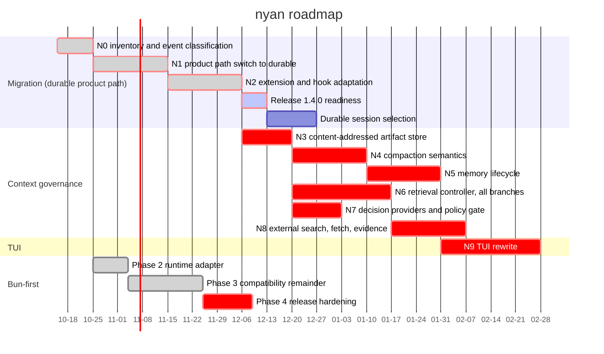

# Roadmap

Planned work and its status. Updated in the PR that changes it.

Last updated: 2026-10-19

WIP rule: No more than two roadmap lines may be active simultaneously.

This roadmap is the single source of truth for planned work and status. Future dates are estimates, not delivery commitments. A task is not considered done merely because source code, a design, or an external Pactile asset exists; its status requires verified Nyan repository or GitHub evidence. Owner recommendations below are planning assumptions, not owner decisions.

## Timeline

The Queue table records complete multi-parent dependencies where the compact Gantt representation uses one primary predecessor. Critical bars identify work waiting on an owner decision or on a task blocked by one. GitHub's current Mermaid renderer keeps the today marker on by default but rejects an explicit `todayMarker on` directive and its style form for this chart; the valid chart therefore relies on that default.

The verified baseline is `origin/main` at `f9fbc89d8` after N2 task C batches C3b and C3c and Bun Phase 3 batch 5d. The Nyan tree has 12 packages and has no `packages/context`, `packages/retrieval`, `packages/decision`, or `packages/coding-agent/src/core/context-governance` implementation. Pactile's source, tests, design documents, evidence fixtures, and the external retrieval worker are available as migration inputs, not as Nyan completion evidence. The 1.3.0 Herdr, Bun, and provider fixes are published; they do not implement Context Governance. On 2026-10-15 the owner fixed the target architecture for compression, memory, retrieval, decision, egress, and the terminal UI, and selected the implementation shape; those decisions are recorded in the [Decided architecture](#decided-architecture-2026-10-15), [Implementation orchestration](#implementation-orchestration-2026-10-15), and [TUI rewrite](#tui-rewrite) sections below. They are planning records, not implementation evidence. Bun Phase 3 closed on 2026-10-19 and N2 closed on 2026-10-19; no implementation line is active until the owner chooses the next one.

### Status key

| Status | Meaning |
| --- | --- |
| Done | Implemented or formally published in Nyan and supported by repository or GitHub evidence |
| Active | Implementation is currently in progress and has a defined gate |
| Partial | A related Nyan slice exists, but the requested item is not complete |
| Queued | No Nyan implementation has started; it is scheduled in the Queue |
| Blocked | Queued work cannot cross an owner decision, permission, evidence, or readiness gate |
| Reference | Design, source, test, or evaluation material exists outside Nyan and still needs a governed port |
| Out of scope | Explicitly excluded from this roadmap |

### Item assessment

The following assessment covers every numbered item from the handoff. A source file, test, design note, or successful probe in Pactile is not counted as a Nyan implementation.

#### Bun-first assessment

| Item | Status | Judgement and destination |
| --- | --- | --- |
| Phase 1 CI and parity | Done | PR #10 added seven-package Bun CI; PRs #12, #13, and #14 covered the remaining package and HTTP differences. |
| Phase 2 runtime adapter | Done | Closed 2026-10-17 by [PR #32](https://github.com/blxzer77/nyan/pull/32). Every inline runtime-identity check in `coding-agent` and `ai` goes through `runtime.ts`. Evidence: PR [CI run 38946496262](https://github.com/blxzer77/nyan/actions/runs/38946496262) (Ubuntu Node and Bun suites, Windows build and check) and [release dry run 38946495937](https://github.com/blxzer77/nyan/actions/runs/38946495937) (six binaries, archives, `SHA256SUMS`, binary smoke with the update smoke test). The boundary and the checks are recorded in [the parallelization note](.agents/notes/implemented/architecture/2026-10-16-bun-runtime-adapter-parallelization.md). |
| Phase 3 HTTP, WebSocket, SQLite, subprocess, and worker work | Done | Bun native fetch and idle-timeout behavior are implemented by PR #13, and WebSocket-related parity fixes are merged. Batch 1 (transport error classification, certificate failures are no longer retried) is merged in [PR #35](https://github.com/blxzer77/nyan/pull/35). Batch 2 gives the two HTTP backends one home (`core/http/`), makes a changed idle timeout reach clients that already hold the fetch on Bun, and adds a one-time warning when `NODE_OPTIONS=--use-system-ca` is set under Bun. Batch 4 runs the durable session store on Bun's own SQLite (`bun:sqlite`, with the Node semantics the storage relies on) so that closing a session releases its files on Windows, and fixes the test-only `--preload` and large-file cases. Batch 5a skips Node's `registerHooks` source resolver under Bun, where tsconfig paths are native, and adds offline `--version` and `--list-models` smoke tests under both runtimes. Batch 5b adds Linux subprocess evidence for the coding-agent bash tool and durable `NodeExecutionEnv`: aborting a command kills its child and grandchild, and stdout/stderr remain complete in the spill file; the new tests pass under Node and Bun. Batch 5c adds direct worker evidence for terminating a synchronous wasm loop and interrupting a microtask loop on abort; the tests pass under Node and Bun. Batch 5d fixes retry classification for certificate-error URLs and Bedrock's prefixed 503 form, shares certificate and fetch-ownership helpers, and tests both runtimes. The former Windows+Bun `EBUSY` and `--preload` failures are fixed by batch 4; the large-file `file-operations` case is a documented Windows+Bun test skip because it is an environment limitation, and CI's Bun matrix runs on Ubuntu only. Closed on 2026-10-19; the gate evidence is under [Active](#active). Not verified: batch 5 on Windows, Git Bash, and macOS (there is no Windows host; the owner tracks Windows coverage separately), and the source CLI and image-resize worker inside a compiled binary. |
| Phase 4 size, startup, signing, and install guidance | Partial | Standalone Bun binaries are released by PR #7 and release attestation is present through PR #15. Size/startup benchmarks, signing certificate scope, and provider-independent install documentation remain. Queue as Bun Phase 4. |

#### Compression and context pipeline assessment

| Item | Status | Judgement and destination |
| --- | --- | --- |
| C1 | Queued | Port Pactile's pure ContextSnapshot, ContextDelta, validated cut-point, source-basis hash, and stale-validation contracts into durable's generic Context Governance runtime in N4. Keep the contracts independent of coding-agent while making durable the Nyan operation runtime. |
| C2 | Queued | Port the Context Surgery decision (`continue`, `mask`, `compact`, `blocked`), protected regions, and mask candidates. Masking is allowed only after payload externalization is verified; implement the policy in N4 and connect storage in N3. |
| C3 | Queued | Make durable's ContextOperation the Context Pipeline: The durable compaction task runs hooks and provider work, revalidates the basis, and commits only against an unchanged conversation; the coding-agent layer supplies product configuration. Implement across N1, N2, and N4; do not add a Host or a second agent loop. |
| C4 | Partial | Nyan already has LLM summaries, split-turn summaries, file-operation details, thinking omission, and summary failure checks. Add Pactile's structured checkpoint/fact boundaries, source binding, and fail-closed validation in N4 and B8; existing summary code is not completion evidence. |
| C5 | Queued | No governed Nyan context pipeline exists. Make the durable compaction task the lifecycle owner and durable storage the transcript owner in N4. |
| C6 | Queued | Replace the single threshold decision with Pactile's admission policy: continue below threshold, mask eligible externalized payloads first, compact only when required, and block when prerequisites or assurance are missing. Implement in N4. |
| C7 | Blocked | Review interaction and `/context review` are product-shape decisions. Do not create Pactile's App review UI or an approval chain until the owner decides whether Nyan should gate actions. |
| C8 | Blocked | Immutable approval grants are not a compression prerequisite for the current TUI design. Keep the contract visible, but defer implementation until the approval/product decision in N4. |
| C9 | Queued | Port CDR/CAR and snapshot/receipt validation as pure checks in N4; verify their real use on the durable path in N4. A receipt or assurance field alone is not evidence. |
| C10 | Queued | Make durable the owner of receipt creation, persistence, checkpoints, and recovery in N3 and N4, verified against the durability of the compaction task. |
| C11 | Queued | Add artifact intents, content-addressed artifacts, memory facts, disclosure metadata, and incomplete-operation recovery through durable in N3 and N4. A tool result cannot be masked merely because its tool appears rerunnable. |
| C12 | Queued | Port the post-compaction audit and fail-closed outcomes in N4: provider failure, summary truncation, stale basis, artifact loss, append failure, and reload mismatch must leave live context unchanged or explicitly blocked. |
| C13 | Queued | Port ContextUnitManifest, anchors, protected-region rules, and source fingerprints in N4. Bind them to durable conversations and entries rather than Pactile workspace/worktree admission. |
| C14 | Queued | Port the reversible context actions in N4. Lossy compression, masking without recoverable artifacts, and permanent drop remain separately authorized and are not silently enabled by the compression controller. |
| G1 | Queued | No governed context coordinator is attached to the agent loop. Implement as a durable task in N4. |
| G2 | Queued | No ContextUnitizer exists for transcript, retrieval pack, or artifact inputs. Implement in N4. |
| G3 | Queued | No Compression Controller exists. Implement the Pactile decision and commit pipeline on the durable compaction task in N4; it must be authoritative for context changes, not proposal-only. |
| G4 | Queued | No deterministic allow, deny, or review gate exists. Implement in N4. |
| G5 | Queued | Recovery, expansion, blocking, supersession, and regression cases are absent. Implement in N4. |
| G7 | Queued | No isolated evaluation controller exists. Implement in N4 without writing product state. |

#### Memory, host, and agent seam assessment

| Item | Status | Judgement and destination |
| --- | --- | --- |
| M1 | Queued | Fact schema, safety scanning, durability, recovery, and authorization are only in Pactile. Port and split in N4 and B3. |
| M2 | Queued | The Pactile ArtifactStore is not integrated in Nyan. Port its contract into durable's Context Governance runtime in N4 and implement the durable-owned artifact store in N3. |
| M3 | Queued | Nyan scope must use git root or cwd rather than Pactile workspace scope. Decide the cross-session location before N5. |
| M4 | Queued | No Nyan `memory_read` ToolDefinition or renderer exists. Implement in N2. |
| M5 | Queued | Durable-owned memory ports are not integrated in Nyan and have no coding-agent session/scope port. Implement in N3 and B3. |
| M6 | Blocked | Memory promotion is not implemented and requires the approval carrier in Owner Decision #11. Queue in N5. |
| M7 | Queued | No `/memory` view and delete flow exists. Implement in N5. |
| G8 | Blocked | Retention and cleanup policy was open in Pactile and still has no Nyan policy. Decide and implement in N5. |
| H1 | Queued | No Nyan ContextOperation ledger is integrated yet. Durable is the selected owner; implement the product-side integration and recovery checks in N1 through N4. |
| H2 | Queued | Durable tool effect intents and receipts are not integrated in coding-agent. Implement in N3 and bind them to the compaction task in N4. |
| H3 | Queued | No durable-backed ContextOperation RuntimeStore is integrated into coding-agent yet. Implement and verify it in N3; do not add a parallel coding-agent SQLite authority. |
| H4 | Queued | No durable-owned content-addressed ArtifactStore is integrated in Nyan. Implement it in N3 and expose it through the ContextOperation runtime. |
| H5 | Queued | Pactile path, case-fold, and NFC utilities are not in Nyan. Reconcile with existing path utilities in N4 and B2. |
| H6 | Queued | No governed run-session composition root exists in the product path. Compose it on the durable Harness in N1. |
| H7 | Queued | No governed checkpoint entry exists in Nyan JSONL sessions. Implement in N2. |
| H8 | Queued | Pactile validation and fingerprint helpers are not in Nyan. Port to N4. |
| Kernel settlement projector | Out of scope | Product Kernel and settlement projection are not part of the requested Nyan roadmap. |
| P1 | Queued | `context_update` is not in the Nyan agent package. Add it only with the required ownership note in N2. |
| P2 | Queued | The undefined tool-result field omission is not verified in Nyan. Add the narrow agent-core seam in N2. |
| P3 | Queued | Pactile's native-agent wrapper must not be copied as an adapter. Attach the needed lifecycle hooks directly to the durable Harness in N2. |
| P4 | Out of scope | Pactile provider-port and Pi adapter layers are unnecessary because Nyan already owns `@ny4n/ai`. |

#### Retrieval and decision-provider assessment

| Item | Status | Judgement and destination |
| --- | --- | --- |
| R1 | Reference | The zero-dependency worker exists only in `D:\MyHarness\pactile`; it is not an Nyan package. Port after the layer decision in N6. |
| R2 | Reference | Worker tests exist externally and are not Nyan evidence. Port selected parity tests in N6. |
| R3 | Reference | Retrieval ABI V3 files exist only in Pactile. Port contracts and planner in N6. |
| R4 | Queued | No Nyan local-worker process adapter exists. Implement Node and Bun paths in N6. |
| R5 | Queued | No Nyan agent retrieval boundary exists. Implement in N6. |
| R6 | Queued | No Nyan retrieval router, ranking, classification, or telemetry integration exists. Implement in N6. |
| R7 | Queued | `code_search` is not a Nyan tool. Implement in N6. |
| R8 | Queued | The semantic branch is an optional, self-hosted remote EmbeddingProvider rather than a fixed EmbeddingGemma implementation. The proposed profile is TEI `jinaai/jina-code-embeddings-1.5b` with client batch limit 32 and target 256 dimensions, but model revision, effective dimensions, normalization, prompt/task profile, precision, batch limit, and response shape must pass readiness checks before use. Provider output remains advisory and degrades to exact/structural retrieval. Implement in N6 and verify the provider profile and refusal matrix before claiming readiness. |
| R9 | Queued | Remote index writes use a self-hosted server-side index coordinator over Qdrant and a strict Tantivy/BM25 service. The coordinator owns staged immutable generations, active-manifest CAS, coordinator epoch/fencing, job leases/checkpoints, reconciliation, rollback, and retention; Nyan never mounts or mutates remote index files. Implement the client protocol and recovery fixtures in N6. |
| R10 | Queued | External Search, Fetch, and Evidence have design material but no Nyan implementation. Implement in N8. |
| R11 | Queued | No Retrieval Controller with branch budgets, deadlines, cancellation, or remote bootstrap ownership exists. Implement the controller in N6 with an idempotent server job protocol: a missing active generation starts a background bootstrap while core exact/structural retrieval returns immediately; stale-generation rebuilds remain independent operations. |
| R12 | Queued | Lexical and relation branches are not in Nyan. Implement deterministic branches in N6. |
| R13 | Queued | Canonical locators, source snapshots, file hashes, generation fences, merged IDs, staged Qdrant/Tantivy generations, and explicit RRF ordering are not in Nyan. Implement them in N6; every candidate must be re-read and checked against the current local source before entering the RetrievalPack. |
| R14 | Queued | Coverage, abstain, insufficient coverage, degraded, blocked, index-building, provider-unavailable, stale-source, and generation-mismatch states are not in Nyan. Implement explicit provider-combination degradation and keep the last active generation serving while bootstrap or incremental sync is building. |
| R15 | Queued | Retrieval capability and egress gates are not in Nyan. Configuring a provider is the authorization, so admission is automatic with the fixed safety constraints; implement the capability snapshot and gates in N7 and N8. |
| R16 | Queued | No Search Provider is configured or built into Nyan. The provider and key remain owner-supplied; implement the adapter and its readiness checks in N8. |
| R17 | Queued | No SSRF-safe Fetch adapter exists in Nyan. Implement host allowlists, HTTPS, redirects, limits, cancellation, and Artifact storage in N8. |
| R18 | Queued | No response-hash-based EvidenceRecord or citation pointer exists. Implement in N8. |
| R19 | Queued | No `web_search` or `web_fetch` tool exists. Implement in N8, after the evidence and citation rules exist. |
| R20 | Queued | Retrieval is not attached to Context Operation epochs, restart recovery, or the client/server source-snapshot contract. Integrate the recoverable RetrievalPack task in N2, B5, B7, and N6; durable converts validated packs to bounded ContextUnits and retrieval never writes Agent state directly. |
| R21 | Queued | No external-link security fixture suite exists in Nyan. Implement in N8. |
| G6 | Queued | Inspect, freshness, source-snapshot, file-hash, generation, scope, revision, coordinator fencing, manifest CAS, and hash fencing are not in Nyan. Implement in N6 with crash/reconciliation, duplicate-job, stale-source, and partial-index fault coverage. |
| J1 | Queued | Jev transport and outbound validation are not in Nyan; the Pactile hard-coded endpoint cannot be copied. The decision provider is a configured capability, so implement the contract and configuration in N7 without a fixed endpoint. |
| J2 | Queued | Rule provider and registry fallback are not in Nyan. Implement in N7. |
| J3 | Queued | Provider policy caps, assurance, and readiness are not in Nyan. Implement in N7. |
| J4 | Queued | The two Pactile Jev clients are not in Nyan and must be consolidated into one client. Implement in N7. |
| J5 | Queued | Retrieval and compression shadow suggestions are not implemented. `shadow` is a per-run branch mode rather than a later phase, so implement suggestion adoption and its receipts in N7 and N4. |
| J6 | Out of scope | Kernel scheduler, tile, task, and verification Jev integrations are excluded; only retrieval planning remains relevant. |

#### Test, evaluation, and evidence assessment

| Item | Status | Judgement and destination |
| --- | --- | --- |
| T1 | Reference | Pactile contract and durability tests exist externally. Port deterministic contract coverage to N4. |
| T2 | Reference | Pactile agent integration tests exist externally. Port applicable tests to N2 and B8. |
| T3 | Reference | Pactile runtime tests exist externally. Port host and recovery coverage to N3, B3, and B4. |
| T4 | Reference | Pactile retrieval tests exist externally. Port worker, planner, pack, and adapter coverage to N6. |
| T5 | Reference | Pactile Jev and provider-probe tests exist externally. Port safe readiness and schema tests to N7. |
| T6 | Out of scope | Kernel, old Pi executor/RPC host, and settlement-outbox tests are excluded. |
| E1 | Reference | P1a fixtures and frozen receipts exist in Pactile but are not in Nyan. Port as evaluation-only fixtures in N4; do not copy internal addresses. |
| E2 | Reference | P0 fixtures and review records exist in Pactile but are not Nyan product evidence. Port only the agreed evaluation assets in N4. |
| E3 | Blocked | The readiness probe exists but contains a tailnet address and cannot enter Nyan. Rewrite as configuration-only readiness checks after Owner Decision #4. |
| E4 | Blocked | The stage 1a runner was not found in the inspected sources. Owner Decision #5 is required before claiming runner parity. |
| E5 | Queued | Paired runs, FI-01 to FI-27, crash, replay, and unknown-outcome tests are new Nyan work in N4 through B9. |

#### Design and reference assessment

| Item | Status | Judgement and destination |
| --- | --- | --- |
| D1 | Reference | Compression decision chain and audit design; rewrite as an English Nyan spec for N4, B4, and B8. |
| D2 | Reference | ContextUnitManifest and protection rules; rewrite for N4. |
| D3 | Reference | Compression and memory evaluation matrix; use as N4 acceptance criteria. |
| D4 | Reference | Legacy migration rules are reference only because Nyan has no Pactile legacy session data. |
| D5 | Reference | Rebase and blocker history is evidence context, not an implementation. |
| D6 | Reference | Shared contracts, ownership, writeset, rollback, and stage plan govern all CG batches. |
| D7 | Reference | Retrieval provider, privacy, evidence, readiness, and evaluation designs govern N6 through B7. |
| D8 | Reference | Pactile agent prompts should become Nyan workflows only when the corresponding entry point exists. |
| D9 | Reference | Dual-product and host-track architecture is a design input; do not create a Pi adapter layer. |
| D10 | Reference | Retrieval bounded-context rules belong in the `@ny4n/retrieval` contract and tests. |
| D11 | Reference | Worker migration and native-agent gap designs guide N2 and B5. |
| D12 | Reference | Pactile implemented decisions must be re-expressed as Nyan notes and verified again. |
| D13 | Reference | Capability, privacy, provider, and workspace-request docs become Nyan user docs only after implementation. |
| D14 | Reference | Retrieval Search Service design is the architecture for N6 and B7, not current Nyan behavior. |
| D15 | Reference | Pactile module catalog is an inventory and status source, not proof of Nyan integration. |

### Acceptance invariant assessment

| Invariants | Judgement and acceptance destination |
| --- | --- |
| 1-5 | First-class failure states, disclosure, no replay of unknown effects, artifact-receipt-manifest ordering, and reversible protection are not implemented in Nyan. Gate N4 through B4. |
| 6 | Jev and embedding must remain advisory and fail-closed. Gate N7 through B8. |
| 7 | Retrieval candidates must be separated from independently verified evidence. Gate N6 and B7. |
| 8 | Egress is denied by default until a provider is configured; each external request then carries a capability and authorization snapshot. Gate N7 and B7. |
| 9-10 | Structured memory, logical references, and user-only deterministic summaries are not implemented. Gate N4, B3, and B9. |
| 11-12 | Evaluation/product isolation and separate authorization for lossy actions, promotion, drop, and egress are not implemented. Gate N4, B8, and B9. |
| 13-14 | Abstain coverage, independent budgets, deadlines, and distinct cancellation/timeout outcomes are not implemented. Gate N6 and B7. |
| 15 | Decision-provider egress must remain separate from external search egress. Gate N7 and B7. |
| 16-17 | Search candidates, citations, stale evidence, SSRF, redirect, size, timeout, and cancellation rules are not implemented. Gate N8. |
| 18 | Source existence, integration, invocation, and verification must remain separate status claims. Apply this rule to every assessment above. |
| 19 | Retrieval, compression, evaluation, and rendering ownership boundaries are not implemented. Gate N2, B4, B5, and B8. |

## Compression implementation plan

Pactile's compression design is the source of truth. The migration removes App, Host, multi-client, logical workspace/worktree, lease/fencing, and Kernel-process assumptions, but does not remove Pactile's context, memory, artifact, receipt, fingerprint, or fail-closed semantics. Under [Shape B](#implementation-orchestration-2026-10-15), compaction is a durable task on the product path rather than a pipeline mounted beside `AgentSession`. This is a plan, not Nyan implementation evidence.

**Ownership**

- Durable owns the context operation: snapshots, deltas, validated cut points, protected regions, surgery decisions, hashes, task phases and memos, artifacts, receipts, checkpoints, and recovery. It carries no product types.
- The durable compaction task owns admission, the summarization request, retry, and the commit of the summary entry. Its effect sandwich is what makes a crash before the outcome commit survivable.
- The coding-agent layer owns only the product surface: tool selection, extension bindings, the system prompt, and the rendering of task state. It does not own context replacement.
- The TUI owns progress, blocked, failure, and retry presentation, rendered from the conversation view. It owns no policy and no persistence.
- Persistent Memory extraction and consolidation are separate tasks. Their failure never rolls back a committed compaction.

**Implementation sequence**

1. **Cut-point safety on the durable compaction task.** Port Pactile's validated cut point, tool-call/result pairing, protected regions, and source/prefix/context hashes. A cut never breaks an arc, and a changed conversation cannot be compacted against a stale basis.
2. **Content-addressed externalization.** Persist original tool-result payloads before any masking, with content hash, source entry ids, basis revision, and disclosure metadata. A missing or mismatched artifact blocks masking.
3. **Mask-first, then summarize.** Mask only payloads backed by a verified artifact read, remeasure, and summarize only if the context is still over budget. A truncated summary, a provider error, or a summary containing a tool call is refused.
4. **Receipt and commit.** Record what the task decided and why, commit the summary entry, and re-read the conversation view. Only then does the live context change.
5. **Failure and recovery evidence.** Verify that a stale basis, a crash between intent and outcome, a failed artifact write, a failed summary, and an unknown effect each leave the live context unchanged or explicitly blocked, and that recovery after restart reaches the same state.

**Acceptance requirements**

- A cut never breaks a tool-call/result arc or retains an unresolved tool call.
- A delayed context edit, a new entry, or a conversation switch cannot be silently lost by an in-flight compaction.
- Masking without a hash-bound recovery path is rejected.
- Failed summary generation, failed artifact or receipt writes, and failed commits do not replace the live context.
- After a restart, the conversation view rebuilt from durable storage plus named artifacts and memory records matches the pre-restart state.

## Implementation orchestration (2026-10-15)

The owner selected **Shape B**: `@ny4n/durable` becomes the product path, and compaction, memory, retrieval, decision, and evidence become durable tasks. Existing JSONL sessions are preserved read-only. The migration is deliberately ahead of the Context Governance work because in Shape B the integration seam disappears: the Harness already owns the durable task, the effect sandwich, checkpointing, and recovery, so the context work is added to a runtime that already has the primitives instead of beside one that does not.

**Why the migration dominates the estimate**

`packages/coding-agent/src/experimental/durable/` already runs a durable coding agent on the durable Harness with SQLite storage, nyan's model runtime, auth, settings, theme, keybindings, and TUI components, plus subagents, `/agents`, the task graph, and `/compact`. Its own README records the property Nyan wants: an interrupted tool call is recovered on restart and the turn finishes, and the TUI only renders the conversation view. This is a prototype, so it is excluded from the build and no product entry point reaches it.

The migration cost is not the context work. It is that Nyan's extension surface is larger than durable's hook surface:

| Surface | Nyan today | Durable |
| --- | --- | --- |
| Subscriptions | 41 in `ExtensionAPI` | 7 hooks |
| Status channel | event bus plus `AgentSession` getters | `Conversation.viewState()`; the spec states there is no public semantic event channel |
| Compaction | LLM summary, split-turn summary, `session_before_compact` | built-in phased compaction task with `select` / `summarize` / `retry` |

The 41 subscriptions cannot be mapped mechanically. Each resolves to exactly one of five destinations: an existing `hook:`; a `durable-capability` that durable must gain; `product-api` for the product shell (trust, registries, input pipeline, provider selection, session lifecycle); `internal-view` for events only the TUI and the non-interactive modes read, now rendered from `Conversation.viewState()`; or `drop` when an intentional removal is explicitly approved.

A name-level match is seductive and wrong, and the first draft of the N0 inventory proved it. An independent review rejected eight of the original `keep` mappings because the contracts differ: `beforeRequest` receives model messages and runs on every request attempt including recovery, not once per run; `afterResponse` receives a terminal assistant message and returns `void`; `onYield` returns only `{ continue }`; and Nyan's `session_before_compact` is last-write-wins with a result carrying `firstKeptEntryId`, `details`, and `usage`, while durable's `beforeCompact` is first-decision-wins and returns only `{ decline }` or `{ summary }`. Only `tool_call` and `tool_result` matched a hook's real contract.

The review also found the inventory incomplete. `on(...)` and `ExtensionAPI` are 72 members but not the whole surface; the UI context, handler contexts, the tool contract, resource loading, the MCP lifecycle, and session tree and fork are affected too and are recorded in the note without member-by-member enumeration.

Two consequences for the phases below. First, N2 is larger than it looked: the corrected inventory requires 8 durable capabilities that do not exist, including a bounded streaming channel, a phased request transform, a provider-payload hook, and a settlement hook that can write entries. Second, `--mode json` and `--mode rpc` are documented interfaces that stream `message_update` and tool events, so the streaming events cannot be reduced to view derivation without breaking a published contract.

Durable already provides the Context Operation primitives: the effect sandwich (`commit intent`, `perform effect`, `commit outcome`), phased checkpointed tasks, entry/context with `head` and `firstKept`, optimistic document writes with bases and bounded replay, three storage backends, and task graph and agent events. It has no content-addressed artifact store, no memory record, no retrieval, and no decision provider; those are the new modules, and the artifact store goes inside `packages/durable` as a general content-addressed store.

**Sequence and gates**

| Phase | Scope | Gate before the next phase |
| --- | --- | --- |
| N0 inventory and extension classification | Deliver `.agents/notes/proposed/architecture/2026-10-15-durable-migration-inventory.md`, its machine-readable `extension-surface.json`, the independent review at `2026-10-15-durable-migration-inventory-review.md`, and `scripts/check-extension-surface.mjs`. Classify all 41 subscriptions and the 31 non-event `ExtensionAPI` members into hook, durable capability, product API, internal view, or drop. Record each member's consumers. Inventory the prototype and the additional surface. Freeze the session directory, lock, and `--continue` policy. No product code changes. | `npm run check:extension-surface` passes, the check is wired into `npm run check`, every member has exactly one destination and every destination has evidence, and the owner has reviewed the note. A review that rejects the first draft is itself acceptable evidence, provided the findings are verified and applied. |
| N1 product path switch to durable | Move the runtime out of `experimental/` into `packages/coding-agent/src/core/`, on the durable Harness with SQLite, `CodingTools`, and nyan's model runtime, auth, and settings. Keep `--continue` and session discovery. Existing JSONL sessions stay readable. | Killing the process mid-tool-call and continuing finishes the turn; `print`, `json`, and `rpc` modes do not regress. |
| N2 extension and hook adaptation | Implement the N0 mapping. Add the 8 durable capabilities the inventory requires, or record an accepted reduction for each one that is not built. Reconnect skills, prompts, themes, images, MCP, tool search, codemode, and the tool contract. Preserve the `print`, `json`, and `rpc` interfaces, including the events they stream. | Built-in and shipped extensions reach functional parity on the durable path; `--mode json` and `--mode rpc` produce the same event types as today; every `durable-capability` entry is either satisfied or has a recorded owner decision reducing it. |
| N3 content-addressed artifact store | Add a content-addressed store to `packages/durable` with scope, basis revision, and read-time hash verification. | Tampering and truncation are detected and no content is returned. |
| N4 compaction semantics | Port Pactile's validated cut point, mask-first policy, structured summary, and receipt onto the durable compaction task. | Stale basis, failed summary, and failed append each leave the live context unchanged; the three are asserted separately. |
| N5 memory lifecycle | Context Memory with exact facts and manifests, plus Persistent Memory typed `user`, `feedback`, `project`, and `reference`, with extraction and consolidation as separate tasks. | A failed extraction does not roll back a committed compaction. |
| N6 retrieval controller | All six branches, the retrieval pack, disclosed failure states, and the optional remote hybrid code-retrieval path described in [the proposed architecture note](.agents/notes/proposed/architecture/2026-10-16-remote-hybrid-code-retrieval.md). The client owns local chunking, scheduling, RRF, current-source validation, and `RetrievalPack`; a self-hosted index coordinator owns Qdrant/Tantivy generations and durable index jobs. | Provider unavailability, timeout, cancellation, denial, stale source/index, generation mismatch, partial publication, bootstrap/incremental-sync failure, and budget truncation are distinguishable and never reported as an empty result. A missing active generation returns core exact/structural results immediately while an idempotent bootstrap runs in the background. |
| N7 decision providers and policy gate | `@ny4n/decision` with the advisory judgment contract, and the deterministic policy gate that decides admission. | A provider judgment never grants authority, and a configured provider runs without per-request approval. |
| N8 external search, fetch, and evidence | `SearchHit` to `Fetch` to `Evidence` to citation, with the fixed safety constraints. | No search hit becomes a citation without a fetch record and a response hash. |
| N9 TUI rewrite | The [TUI rewrite](#tui-rewrite) design. | Every durable operation state renders from the view, and no recovery logic lives in the TUI. |

N0, N1, and N2 are complete, and Bun Phase 2 and Phase 3 are closed; every phase carries a gate that must pass with recorded evidence before the next phase starts, and each phase is a separate change that can be reverted on its own. The Bun Phase 2 boundary and reservation are recorded in [the parallelization note](.agents/notes/implemented/architecture/2026-10-16-bun-runtime-adapter-parallelization.md).

## Decided architecture (2026-10-15; retrieval revision 2026-10-16)

These decisions fix the target design. They are planning records taken with the owner during this roadmap update, not implementation evidence. The retrieval revision records the owner's self-hosted C/S decision and the reviewed remote hybrid index contract; it does not claim that the client, coordinator, or providers are implemented.

**Product path**

- The durable Harness becomes Nyan's product path. The prototype in `packages/coding-agent/src/experimental/durable/` is promoted out of `experimental/`, and the terminal UI renders `Conversation.viewState()` instead of `AgentSession`.
- Existing JSONL sessions are preserved read-only. Nyan does not migrate, rewrite, or delete them, and new sessions are written through durable storage.
- The non-interactive `print`, `json`, and `rpc` modes keep their current interfaces.

**Compression and context operations**

- `@ny4n/durable` owns the Context Operation: snapshot, cut-point validation, artifact externalization, mask-first policy, summary, receipt, checkpoint, recovery, and reconciliation. Its effect sandwich and phased task checkpointing are the recovery mechanism, so Nyan does not build a parallel operation state machine.
- Compaction is a durable task. The live-context swap happens only after the task commits and the conversation view is re-read; a stale basis, a failed append, a failed artifact or receipt write, a truncated summary, or an unknown effect leaves the live context unchanged and is surfaced as blocked or unknown rather than retried.
- A cut never breaks a tool-call/result arc. A stale basis, a failed append, a failed artifact or receipt write, a truncated summary, or an unknown effect leaves the live context unchanged and is surfaced as blocked or unknown rather than retried.

**Memory**

- Two layers over one storage substrate. Pactile's Context Memory keeps its exact-fact, artifact, receipt, and manifest-CAS semantics. Persistent Assistant Memory adds cross-session records typed `user`, `feedback`, `project`, and `reference`.
- Exact facts, derived summaries, and persistent records stay structurally separate. A summary is never an exact fact source, and a retrieval hit never becomes a fact.
- Memory promotion is policy-driven and automatic for low-risk, well-sourced records; conflict, low confidence, and sensitive content stay as candidates or require review. Lossy compression, permanent drop, and memory deletion remain separately authorized and are not enabled by the compression controller.
- Extraction, consolidation, and read are separate durable operations. A failed extraction never rolls back a committed compaction.

**Retrieval**

- One Retrieval Controller with every branch available from the start: `exact`, `structural`, `lexical`, `relation`, optional remote `semantic`, and `external_search`. The semantic branch is a configurable self-hosted provider, initially profiled around TEI `jinaai/jina-code-embeddings-1.5b`; EmbeddingGemma is not a fixed Nyan dependency. Capability, authority, permission, and degradation are expressed as per-run state, not as roadmap phases.
- The optional local-code hybrid path is client/server separated: the client performs Tree-sitter chunking, breadcrumb enrichment, embedding batch scheduling, local RRF, current-source validation, and `RetrievalPack` construction; a self-hosted index coordinator manages staged immutable Qdrant and strict Tantivy/BM25 generations, active-manifest CAS, coordinator epoch/fencing, durable jobs, reconciliation, and retention. The client never mounts or mutates remote index files.
- A missing active remote generation does not block the core path: exact/structural retrieval returns immediately while an idempotent bootstrap runs in the background. Incremental sync uses source snapshots, file hashes, tombstones, checkpoints, and the same active-generation publication protocol; the last active generation remains in service until the new one is validated.
- Deterministic branches are authoritative. Embedding output is advisory and never proves that a file exists, that a line range is valid, or that no other match exists. Remote candidates must be re-read and checked against the current local source before context admission.
- External search is strictly `SearchHit -> Fetch -> Evidence -> citation`. A search hit never enters the result set and never becomes a citation.
- The controller's only output is a pack carrying `items`, `rejected`, `coverage`, `fallback`, `budget`, and `abstain`. Provider unavailability, timeout, cancellation, permission denial, stale source/index, generation mismatch, partial publication, budget truncation, and dimension mismatch are distinct disclosed states, never an empty result. Retrieval returns a provider-neutral `RetrievalPack`; durable converts it to a bounded `ContextUnit` and owns recovery admission.

**Decision and egress**

- Jev is a Decision Provider: it returns structured advisory judgments and holds no authority. `@ny4n/decision` owns the provider contract, registry, judgment schema, readiness, adoption rules, and decision receipts. Nyan reuses `ctx.modelRegistry.classify()` for the rule path rather than porting a fixed endpoint or a second transport.
- The deterministic Policy Gate decides admission. It checks scope, data class, quota, egress, protected regions, basis freshness, and artifact durability.
- Configuring a remote provider is the authorization. Self-hosted retrieval services configured under the owner's internal network policy run automatically without per-request approval; the client accepts only configured service identities, ports, and protocols, rechecks redirects, and enforces size, timeout, cancellation, and response validation limits. Public/external search and fetch retain HTTPS, SSRF, private-network blocking, host allowlists, redirect rechecks, response hashing, and evidence-record constraints. An unconfigured provider produces a named unavailable or denied state and sends no request.

## TUI rewrite

The owner decided on 2026-10-15 to rewrite the terminal UI rather than extend the current renderer. The design is a governed port of verified open-source interaction patterns, not a copy of any single product's surface. Sources below were read at the source level during this update.

| Area | Reference and evidence | Nyan decision |
| --- | --- | --- |
| Structure | Codex `codex-rs/tui/src/bottom_pane/` hosts the composer and every modal (approval overlay, command popup, config panel); Codex `app/agents_overview*` is a separate full-screen view. OpenCode uses a dialog stack plus `component/panel-host.tsx`, with a toggleable sidebar bound to `<leader>b`. Gemini CLI uses `DialogManager` plus `InboxDialog`. Crush keeps a sidebar but gates it behind compact mode. | Transcript area plus a bottom modal region plus an overlay stack. No permanent operations sidebar. |
| Operations | Codex `agents_overview` groups by `All / Needs you / Working / Ready / Inactive`. | One operations overlay for durable Context Operations, Memory, Retrieval, and Decision state, using the same grouping semantics. |
| Keybindings | OpenCode `packages/tui/src/config/keybind.ts` defines `LeaderDefault = "ctrl+x"` and gives every binding a description, alternatives, and a `"none"` value. tmux 3.7c uses `C-b`; Herdr 0.9.5 uses `ctrl+b`; the zellij default preset declares `primary "Ctrl"` and binds `ctrl+b/g/h/L/n/o/p/q/R/s/S/t`. | Leader `Ctrl+X`, verified free in all three environments. `Ctrl+B`, `Ctrl+O`, and `Ctrl+P` are avoided because the multiplexers claim them. |
| Theme | Gemini `themes/semantic-tokens.ts` separates `text`, `background`, `border`, `ui`, and `status` and ships 16-color `ansi-dark` / `ansi-light` fallbacks. OpenCode `ResolvedThemeTokens` adds `hue`, `categorical`, `scrollbar`, `diff`, `syntax`, and `markdown` with a `surface(name)` derivative. Crush invalidates render caches on theme change. | A semantic token layer with truecolor, 256-color, and ANSI-16 tiers. The palette is pink-led: accent `#FF9EC4`, bright accent `#FFC2DA`, base `#171318`, raised surface `#2B202A`, border `#6E4B5D`. |
| Transcript | Codex `history_cell/` with `markdown_render_cache`; Crush `cachedMessageItem` plus `ClearItemCaches`. | Rendered transcript cells with a cache invalidated on theme or width change. |
| Activity grouping | Codex `app/activity_groups.rs` joins adjacent activity without rewriting terminal scrollback. | Tool calls and context operations collapse into an expandable group. |
| Composer | Codex splits the composer into separate draft, footer, popup, slash, history, paste, and layout states, with a documented paste state machine. | The composer is a state machine, not a text field. |
| Attention | OpenCode gates notifications and sounds per event kind. | Notify on blocked, failed, and finished, with the host owning cross-pane routing. |
| Screen mode | Crush and Codex take over the alternate screen. | Alternate screen with in-app scrolling. |
| Host relationship | Herdr already provides the agent sidebar, notifications, `agent wait`, state rollup, and resume restore through `pane report-agent`. | Nyan reports state and does not duplicate the host sidebar. The layout compact below a width threshold. |

The rewrite is a new line that does not change the non-interactive `print`, `json`, or `rpc` modes. Its shell, theme, and keybind registry can proceed independently; operation-state wiring depends on N2.

## Active

| Line | Item | Owner | Branch / PR | Next step |
| --- | --- | --- | --- | --- |
| Release | 1.4.0 readiness: durable TUI parity | Blxze | none yet | The pre-release check of 2026-10-19 found that the default interactive mode, the durable TUI since N1, handles 4 of the legacy TUI's 24 built-in slash commands (`/model`, `/tasks`, `/agents`, `/compact`) and no `!`/`!!` user bash, and that every other command is sent to the model as a prompt (reproduced in tmux with `/settings` and `!echo`). N1's gate checked print, JSON, and RPC only and N2 covered extensions, so no item owned it. R0 inventories the legacy interactive surface against the durable TUI; R1 onward port it, with each item either implemented or a recorded reduction, and no built-in command ever reaching the model. |
| Release | 1.4.0 readiness: release fixes | Blxze | F1: branch `r-fix-f1-continue` | F1 fixed `--continue` per Decision #32: it continues the directory's newest durable session, reopens the newest legacy JSONL session read-only when the directory has only that, and otherwise starts a new session, and a durable startup condition (a held session, an unresolvable `--model`, `--api-key` without a model) prints one line instead of a stack trace. Still open: the CLIProxyAPI "not configured" line every run prints for users without CLIProxyAPI; the `openai-completions-tool-choice` test that names a model models.dev no longer lists, which fails `npm run check` in a fresh checkout; durable sessions in `docs/sessions.md`; then, once the TUI line closes, the 1.4.0 changelog with a Breaking Changes section (Decision #33) and a current record of unresolved items. |

The two rows are one line, so the WIP rule holds. Versioning, tagging, and publishing stay with the owner.

The release-ready stop condition is recorded in [`docs/handoff/2026-10-18-reinstall.md`](docs/handoff/2026-10-18-reinstall.md): finish the N2 and Bun gates, run the latest-main checks and release dry run, then stop without versioning, tagging, publishing, or creating a release.

Bun Phase 3 closed (2026-10-19, batches 5a–5d in [PR #61](https://github.com/blxzer77/nyan/pull/61), [PR #62](https://github.com/blxzer77/nyan/pull/62), [PR #64](https://github.com/blxzer77/nyan/pull/64), [PR #65](https://github.com/blxzer77/nyan/pull/65)): on `ee2062719` (the merge of #65; the gate branch added only roadmap text on top of it), `npm run check` passed and the affected tests passed under Node (329 passed, 8 skipped) and Bun (334 passed, 3 skipped); each batch PR passed Ubuntu Node and Bun, Windows build and check, MCP conformance, Deep verification, and the Merge gate; [release dry run 39198865239](https://github.com/blxzer77/nyan/actions/runs/39198865239) passed every job, including `Publish verified artifacts`, the Bun binaries, and the four binary smoke tests. The accepted Bun-versus-undici differences (proxy forward form, redirect hop limit, no connection-attempt timeout, no HTTP/2 switch) are recorded in [the Bun native fetch note](.agents/notes/implemented/architecture/2026-10-13-bun-native-fetch.md). Windows evidence for batch 5 is not a gate condition: on 2026-10-19 the owner confirmed there is no Windows host and that Windows coverage is tracked separately. Left open: Mistral's error formatter still duplicates the shared normalizer because the two differ in behavior; codemode admission beyond two workers is Decision #26.
Bun Phase 2 closed (2026-10-17, [PR #32](https://github.com/blxzer77/nyan/pull/32)): `npm run check` exits 0 after the rebase onto `main`; the 31 targeted `coding-agent` test files pass under Node (236 passed) and Bun (237 passed); PR [CI run 38946496262](https://github.com/blxzer77/nyan/actions/runs/38946496262) is green (the Bun job's `apt-get` lock failure passed on rerun); [release dry run 38946495937](https://github.com/blxzer77/nyan/actions/runs/38946495937) built the six binaries, their archives and `SHA256SUMS` and passed binary smoke including `smoke-test-binary-update.mjs` on four platforms. Known problems left open: the dry run's `Publish` job failed because `1.3.0` was already on npm (`publish-packages.mjs` skipped published versions only outside a dry run, and `release.yml` moved to Node 24 in #29); fixed by [PR #33](https://github.com/blxzer77/nyan/pull/33), which packs a published version in a dry run; and `test/tools.test.ts` `executeBash should persist full output when truncation happens by line count only` races the output file it reads (seen under Bun locally and on Ubuntu in `Verify`; owned by N2). Not verified: the Linux sandbox branch of `restoreSandboxEnv()`. The Windows results of the full Bun suite (`durable` `EBUSY` and `--preload` file URL, `file-operations` timeout) are Phase 3 evidence.

N2 gate evidence (2026-10-19, implementation branch `n2-gate`): the gate ran after G1a (#90), G1b (#91), and W1 (#92) merged, and all three batches' reports are in the orchestration handoff. `npm run check` exits 0 on the gate branch, including `check:extension-surface`: every one of the 41 events and 31 `ExtensionAPI` members has one recorded destination, every `durable-capability` is satisfied on the durable path with the PR or test that proves it, or is reduced by an owner decision, and the two tree events are the only events recorded as reductions (Decisions #24 and #31). Event-type parity holds: `test/event-type-parity.test.ts` compares the event types and the RPC responses of both paths across 19 scenarios and passes under Node and Bun, and the one type set it asserts as different is the legacy retry `context_edit` `entry_appended`, which is a Decision #31 reduction; `session_before_tree` and `session_tree` are the other two, and nothing else differs. Built-in extensions reach their surface on the durable path: `test/durable-gate-builtins.test.ts` pins the four `builtin:` paths that load (`cliproxyapi`, `herdr`, `llama.cpp`, `mcp`), the two built-ins that give way to durable's native `codemode` and `tool-search`, the llama.cpp and cliproxyapi providers in the durable model runtime, and the exact extension command list the durable modes offer (`cpa-*` plus `fast`, `pause`, `continue`, `llama`, and `mcp`); their behaviour is covered by `durable-extension-host`, `durable-builtin-run-events`, `durable-mcp`, `durable-codemode`, and `durable-tool-search`, and the durable path now also honors `cacheWarming` (W1). The durable TUI keeps the five-method extension UI subset (Decision #28) and session selection stays outside N2 (Decision #25). The [hooks note](.agents/notes/implemented/architecture/2026-10-16-durable-n2-capability-hooks.md) moved to `implemented/` with the gate's verification section. Not verified at the gate: Windows (no Windows host; the owner tracks Windows coverage separately), a kill between a boundary hook and its commit (the nearest test closes the harness instead), a real Herdr process, a real browser OAuth sign-in, and a real subprocess `--mode rpc` with a provider that cannot be injected in-process; the per-batch evidence below lists the rest.

N2 C3b evidence (2026-10-19, merged PR #63, squash `f11f7f592`): the durable host now exposes extension command dispatch and command metadata; durable TUI commands use the five-method UI subset (`notify`, `setStatus`, `select`, `confirm`, `input`) with `ctx.hasUI === true`, RPC uses the existing extension UI request/response records, and JSON/print leave `ctx.hasUI === false`. The durable host test passes under Node and Bun with a faux extension and isolated temporary home. The remaining UI surface (widgets, header/footer, editor, autocomplete, and custom components) is deferred to N9 by owner Decision #28 (accepted 2026-10-19).

N2 C3c evidence (2026-10-19, merged PR #66, squash `f9fbc89d8af2440f0fb0e924c91585e7374d470a`): durable `before_agent_start` effects are staged once per submitted run and apply injected user content and a changed system prompt to the first request; lifecycle events cover `agent_end`, `agent_settled`, model-selection, boundary, stream, tool-update, and compaction handlers; the durable host exposes a read-only linear session-manager facade. Targeted durable host/resource/route/JSON tests pass 29/29 under Bun and the host/resource tests pass 17/17 under Node. The exact fidelity reduction for durable boundary drafts/final entry IDs and the legacy compaction `firstKeptEntryId` cannot cross the durable branded-entry boundary without an owner decision; this is Decision #29 before the N2 gate.

N2 C3d evidence (2026-10-19, merged PR #68, squash `0f617e561ef27db454ae30d99e5188cd9a6f8763`): resource flags `--extension`, `--theme`, and `--prompt-template` remain on durable; prompt templates expand in interactive, print, JSON, and RPC; RPC reports prompt commands; durable TUI registers custom themes before applying settings. With isolated temporary HOME and loopback provider stub, the six-file Node and Bun targeted suite passed 86/86 each, and `npm run check` plus the unbundled coding-agent build passed. CPA A4, A5, A7, A8, and A11 were deliberately moved to C3e; see `reports/n2-c3d-routing.md`.

N2 C3e evidence (2026-10-19, merged PR #72, squash `754d2bfc37f886b1309dda9e5d27f28d41251e38`): the loopback CPA stub verifies quota-header parsing (A5), transient stream normalization and one retry (A7), one request record per terminal assistant (A8), rejected quota fingerprint suppression across reused durable services (A11), and pause/close/reopen/continue recovery (A4). Durable settings diagnostics now deduplicate by type/message. The six-file Node and Bun targeted suite passed 91/91 each with isolated temporary HOME; `npm run check` and the unbundled build passed. A4 ownership is explicit: the caller owns the pending submission waiter, close rejects that waiter with the closed-harness error, while the durable generation task remains persisted and resumes once the same session is reopened with `continueSession`; the provider request is sent once after `/continue`.

N2 C3f evidence (2026-10-19, implementation branch `n2-c3f-boundary-proposals`): boundary drafts now round-trip between legacy extension proposals and durable `BoundaryEntry` records. Custom entries and custom messages carry JSON metadata; user/custom-message context edits map to durable omit/replace edits; assistant/tool-result edits and compaction boundary drafts are refused with diagnostics. `turn_end` and `agent_before_settle` previews include the durable session projection; tool-result ids and turn indices are populated where durable has them. Compaction proposals use durable's selected cut; a different legacy `firstKeptEntryId` is reported and not applied. Recovery remains durable-owned, so a boundary handler may run more than once before its commit. Merged as PR #73 (squash `edcf57e6f`).

N2 C3g evidence (2026-10-19, implementation branch `n2-c3g-boundary-tests`): the C3f acceptance paths had never worked in a real session. `createExtensionHost` passed `createProviderHooks` its placeholder session manager, whose every method throws, instead of the controller's facade, so a boundary event's `toolResults`, `toolResultEntryIds`, and `context` preview were empty and a `context_edit` of a user or custom message was refused every time, because the adapter reads the target through that facade and treats a throw as "not found". The one-line fix is in `extension-host.ts`. The new tests drive a real durable session with the faux provider and assert: `omit` and `replace` of a custom message change the next request's messages; a tool round's `turn_end` carries the real result message and the durable ids of the assistant and result entries, and a final answer carries none; each refusal separately and with its exact notice (reserved `nyan.` kind, non-strict data, a target outside the context, an assistant target, a tool-result target, a compaction draft); `session_before_compact` adopts a matching summary and details, keeps the durable cut and reports a different `firstKeptEntryId` while still using the summary, and reports non-JSON details and unattributable usage while keeping the summary; a boundary handler interrupted before its commit (the Harness is closed while it is parked), then a reopen with `continueSession`, runs again and its entry is written exactly once. The proposal mapping no longer stamps proposed user messages with the clock but with the boundary's assistant timestamp, so a rerun on the same input proposes the same entries. The targeted Node and Bun runs pass 35/35 each; sixteen single-point mutations of the adapter and host each fail at least one named test and none survives. `npm run check` exits 0. Not verified: a crash of the real process (the test closes the Harness; the durable boundary-commit recovery itself is argued in the hooks note and not run there either), the durable TUI honoring `display: false`, and the Windows and macOS hosts. Found, not fixed: with a `turn_end` handler parked, `Harness.close()` was still pending after 20 s and returned only when the handler was released, and `ctx.signal` is undefined inside that handler, so a handler that never returns blocks closing the session (a provider hook such as the pause gate is released by the close; whether the legacy path behaves the same was not checked).

N2 task B1 evidence (2026-10-19, `n2-b1-session-ops`): the durable RPC path now answers `clear_queue` (withdraws the conversation's queued inputs and returns their texts), `get_entries` (durable entries in the legacy entry shape, in append order, with a `since` cursor and `leafId`), `set_session_name` (stored in `session.json` beside the database; an empty name clears it), `export_html` (the existing exporter over the mapped session), and `get_state.sessionName`. A compaction entry's `tokensBefore` is an estimate of the context before the summary, because durable records the summary and not the provider's count. `abort_retry` stays unavailable: the durable retry wait is the generation task's `retry` phase and only `abortTask` interrupts it, which aborts the whole run; recorded as Decision #30. The new `test/durable-rpc-session-ops.test.ts` drives the durable RPC module in-process (`runDurableRpc`, the same module `--mode rpc` runs on the durable path) with a faux provider and a temporary home, and its five tests pass under Node and Bun; each of the four implemented behaviors was checked by disabling the code under test and confirming its test fails. Not verified: a subprocess `--mode rpc` invocation with a provider that cannot be injected in-process (`--extension` still routes to the legacy path), and `get_entries` over a session large enough to span several storage pages.

N2 task B2 evidence (2026-10-19, merged PR #71): the durable RPC path answers `fork`, `clone`, `get_fork_messages`, and `get_tree` per Decision #24 option A. `fork` requires a user message entry and calls `Conversation.fork(at)`; `clone` forks at the newest entry; both switch the controller to the new conversation and move the adapter's event stream to it through a new `OpenDurableResult.eventsOf` member, so later prompts and events belong to the fork while `sessionId` and `sessionFile` stay unchanged. `get_fork_messages` lists the session's user entries, and `get_tree` returns the active entry chain as a linear tree (recorded reduction). `switch_session` still answers unavailable: opening a given session directory needs an exact-directory open in `core/durable/sessions.ts`, which task B does not own, so it is requested from the orchestrator instead of implemented. The same in-process test file drives the adapter with a faux provider and a temporary home; its eight tests pass under Node and Bun, and each of the four new behaviors plus the event-stream move was checked by disabling the code under test and confirming its test fails. Not verified: a fork in a session large enough to span storage pages, and the durable TUI's conversation list, which labels the forked conversation like a subagent.

N2 task B2b evidence (2026-10-19, merged PR #75, squash `e2238562a1ea88d6d9255a6f45b0d18128c17603`): the durable RPC path opens an exact existing session directory, acquires its directory lock before closing the current session, uses the target's recorded cwd, and emits a resumable `session_start` with `previousSessionFile`. New durable sessions record cwd in `session.json`; old sessions without cwd, missing cwd directories, locked targets, and legacy JSONL files return named `DURABLE_SESSION_*` failures while leaving the current session available. The switch reuses the process services and extension instances, and the RPC event stream and subsequent prompts follow the target session. The session-ops RPC test has 14 cases, passes under Node and Bun, and its switch behavior, cancellation, target cwd, lock, old metadata, legacy JSONL, and current-session preservation branches were mutation-checked. The targeted Node and Bun regression set passes 45/45. `npm run check` passes. Not verified: Windows (no Windows host; the owner tracks Windows coverage separately), a real subprocess RPC with a provider unavailable to in-process faux-provider injection, or a multi-process lock test beyond the proper-lockfile fixture.

N2 task B3 evidence (2026-10-19, implementation branch `n2-b3-bash`): durable RPC `bash` runs through the durable `ExecutionEnv.exec`, streams `bash_execution_update`, supports `abort_bash` through per-command in-memory abort controllers, and records a `bashExecution` entry whose legacy-formatted user message is omitted when `excludeFromContext` is true. The shared bash executor now times out while closing full-output files, removes spill files on command-failure paths, and does not report spill-write failures when the sanitized result was not truncated. The durable RPC/session and bash executor/tool tests pass 104/104 under Node and Bun. Each new durable bash path and the no-spill-error condition was mutation-checked. `npm run check` passes. The hooks note records that command execution precedes transcript commit; a crash in that interval leaves the external command outcome unknown and is not replayed automatically. Not verified: Windows (no Windows host; owner tracks Windows coverage separately), true subprocess RPC with a real provider, or a fault-injected crash between command completion and the durable entry append.

N2 task C G1b evidence (2026-10-19, implementation branch `n2-g1b-host-events`): the extension host now bridges the five Decision #31 items that belong to it. `agent_start` and `turn_start` are forwarded from the committed event stream that `--mode json` already reads, through one watch that exists only when a loaded extension handles either event and that `switchConversation` moves, so a fork, a clone, and a subagent switch follow the conversation the session talks to; `turn_start` reports the run's completed-turn index, which `run_start` resets and every committed `turn_end` advances. The built-in `herdr` and `mcp` integrations now work on this path: a fake Herdr binary receives `--state working` when the committed `agent_start` arrives (and `idle` when the run settles), and a loopback MCP endpoint refuses the startup connection, is signed in to from outside the session through `mcp-auth.json`, and receives the second connection carrying that token when `turn_start` arrives. Herdr needed one more fix: the runner's `ctx.mode` was `print` during `session_start` because a mode binds its UI context after `openDurable` returns, so the host now sets the mode the open was asked for. `context_with_system` runs as phase two of the request transform in `beforeRequest`, after `transformConversation` and with the full transcript, and its output is the request; `ExtensionRunner.emitConversationContext` was split out so phase one is not run twice, and an unchanged result leaves the request untouched instead of collapsing its positional system entries. `input` runs at the controller's `submit` and `submitAndWait`, before skill and prompt-template expansion (expansion moved into the controller and `DurableController.expandPrompt` is gone), with `source` and `streamingBehavior` as legacy passes them; `submitAndWait` answers `SubmitOutcome`, so RPC reports `disposition: "handled"` and print and JSON exit without a request. A fork asks `session_before_fork` before it reads the entry, emits `session_shutdown` with reason `fork`, and starts the forked conversation with `session_start` reason `fork` and the session's file, which durable does not change (Decision #24). Two defects were found and fixed: `ctx.sessionManager` kept reporting the first conversation's entries after a switch, and `emitContext` in the `context` hook would have run phase two twice. New tests: `durable-run-events.test.ts` (2), `durable-builtin-run-events.test.ts` (2), `durable-context-with-system.test.ts` (4), `durable-input-event.test.ts` (5), and `durable-fork-lifecycle.test.ts` (4), which pass under Node and Bun along with the 22 existing durable files and the extension runner, input-event, print-mode, and event-parity files (215 Node cases). Thirteen mutations (each new emit, the mode binding, the watch, the phase-two call, the unchanged-request guard, the `handled` branch, the post-handler expansion, the fork guard, shutdown, and start, and the facade follow) each fail a named test. `npm run check` exits 0. Not verified: Windows (no Windows host; the owner tracks Windows coverage separately), a real Herdr process and a real browser OAuth sign-in, and the durable TUI's own mode binding, which the tests drive through `openDurable`.

N2 task C G0b evidence (2026-10-19, implementation branch `n2-g0b-surface-audit`): every `durable-capability` and every event mapping in `extension-surface.json` is labelled in the [hooks note](.agents/notes/implemented/architecture/2026-10-16-durable-n2-capability-hooks.md) as satisfied with the PR or test that proves it on the durable path, or as a recorded reduction (Decisions #23, #24, #29). The audit found six events that no durable path emits or bridges: `context_with_system` (the phase needs the full transcript), `agent_start` and `turn_start` (consumed by the built-in `herdr` and `mcp` extensions), `session_before_fork`, `session_tree`, `session_before_tree`, and the product-shell events `input`, `user_bash`, and `cache_warming_decision` with no built-in consumer; Decision #31 records them and recommends the fix. The `agent_end` signal difference was settled by measurement: the host awaits the settled handlers, but `close()`, RPC `new_session`, and the next prompt do not join that wait, so a parked `agent_end` handler holds none of them (new `test/durable-settled-handlers.test.ts`, 4 cases, Node and Bun). The measurement exposed a real defect: the staged `before_agent_start` effects were cleared after the settled handlers, so a prompt submitted while one was parked lost its injected message; the staging is now cleared when the run settles, before the handlers, and the test asserts the second prompt's message reaches its own request. `npm run check` passes.

N2 task B4 evidence (2026-10-19, implementation branch `n2-b4-abort-retry`): durable now has a retry-only stop, as Decision #30 approved. `Conversation.stopRetry()` takes the request for every `nyan.generation` of that conversation that sits in its `retry` phase and resolves whether one was waiting; it writes nothing and aborts nothing. A generation in that phase waits with the new `TaskRuntime.retrySleep()`, which a stop cancels through a controller of its own, so a request that arrives before the wait starts is consumed when it does and one that arrives during it ends it at once; an abort of the task or of the caller's context still throws there and ends the run as aborted. The stopped phase commits what exhausted retries commit, through the new shared `modelErrorRun()`: the inputs settle `unanswered` with `model_error`, the detail is `live.generation.retry.error`, and the generation is terminal `failed`, with the failed attempt still the last entry and no further request sent. The request is in memory, so a close or crash before that commit keeps the retry checkpoint and the reopened task waits again; compaction retries are not targeted. Durable RPC `abort_retry` calls `DurableController.abortRetry()` on the active conversation and reports success, including when nothing was waiting, as legacy does. The durable spec and `docs/rpc*.md` record the behavior. The new `test/harness-stop-retry.test.ts` (5 cases) and the compaction scope case in `harness-compaction.test.ts` pass under Node and Bun, and `durable-rpc-session-ops.test.ts` (16 cases) covers the RPC command under both. Each branch was mutation-checked: removing the stopped-retry branch, the pending mark, the waiter cancel, the kind check, the live error detail, the RPC branch, and the controller call each fail at least one named test; the `!invocation.controller.signal.aborted` guard on the wait is a race guard whose removal keeps every test green, because a task abort is checked before the phase failure either way. The whole `packages/durable` suite passes twice (1371 passed, 8 skipped, both with and without document retention), the targeted `coding-agent` durable RPC, JSON-event, and route files pass 28/28, and `npm run check` exits 0. Not verified: Windows (no Windows host; the owner tracks Windows coverage separately), a real subprocess RPC with a provider that cannot be injected in-process, and a crash in the window between a stop request and its commit in a real process (the restart case closes the Harness instead).

N2 task C3h evidence (2026-10-19, implementation branch `n2-c3h-handler-signal`): every durable hook member that calls an extension handler now runs it in the run's scope, so `ctx.signal` is the run's abort signal for the `context`, `message_end`, `message_update`, `tool_call`, `tool_result`, `tool_execution_update`, `turn_end`, `agent_before_settle`, and `session_before_compact` handlers, which read `undefined` before (the provider callbacks already had it, and `beforeRequest` runs no handler). `close()`, RPC `abort`, and `new_session` each abort the run invocation whose context the hooks see, so a `turn_end` handler that waits for the signal no longer holds them up; a handler that ignores the signal still does, which is the durable close guarantee and matches legacy. `agent_end` and `agent_settled` run after the run settles and `before_agent_start` before it exists, so those handlers have no signal, as before. The durable TUI now shows a boundary `custom_message` entry as plain text with its custom type and keeps `display: false` hidden. New `test/durable-handler-signal.test.ts` (6 cases) and `test/durable-custom-message-view.test.ts` (3 cases) pass under Node and Bun; each of the 12 hook members and the `display` check was mutation-checked by removing the scope or the check and confirming a test fails. Not verified: the TUI rendering in a real terminal, and Windows (no Windows host; the owner tracks Windows coverage separately).

N2 G0a evidence (2026-10-19, implementation branch `n2-g0a-event-parity`): `test/event-type-parity.test.ts` runs each scenario through the legacy runtime that `runPrintMode`/`runRpcMode` receive and through `runDurableJson`/`runDurableRpc`, with the same extensions and one paced faux provider, and compares the JSON event types plus the RPC response commands: a plain text answer, a tool round with a partial result, a bash tool round that streams output, a boundary `custom` entry, a boundary `custom_message`, one retryable error followed by a retry, and RPC prompt, `set_thinking_level`, an extension command, an extension handler that throws, abort, `new_session`, `fork`, `bash`, and `set_session_name`. Four gaps were fixed in the adapter: a durable `entry_appended` was dropped and a boundary `custom_message` published no entry at all, `agent_changed` published no `thinking_level_changed`, a `bashExecution` entry published `message_start`/`message_end` for a command legacy publishes nothing for, and `tool_execution_update` carried neither the call's `args` nor the output so far, while `turn_end` carried no `toolResults` and `tool_execution_end` no `durationMs`; the durable RPC `set_session_name` now publishes `session_info_changed`. Each fix was mutation-checked by disabling it and confirming a named test fails. Four differences are asserted with their reason instead of fixed: a retried turn publishes no `entry_appended` for a `context_edit` (durable leaves the failed attempt out of the request without an entry), legacy RPC publishes `extension_error` and durable reports it as a notice, `queue_update` is not published because durable's `inbox_update` carries item ids and modes rather than texts, and streamed partials commit at most every 100 ms so a fast provider yields no `message_update`. The targeted Node and Bun runs pass 32/32 each and `npm run check` exits 0. Not verified: nested tool calls (`ctx.executeTool`), whose durable end result is not mapped onto the published `result`, and Windows (no Windows host; the owner tracks Windows coverage separately).

N2 G1a evidence (2026-10-19, merged PR #90, squash `6b2498dab`): the four RPC/JSON items of Decision #31 are on the durable path. `--mode rpc` `bash` emits `user_bash` with the command, `excludeFromContext`, and the session cwd, and honors the answer as legacy does: `operations` replace the local execution, and a `result` replaces the execution (the command does not run, and `DurableController.recordBashResult` records it and returns it); a handler that throws fails the command. Extension failures reach the adapter through the new `OpenDurableResult.onExtensionError`, so `extension_error` is published with the same `extensionPath`, `event`, and `error` as legacy while the view keeps its notice; `new_session` and `switch_session` rebind it. `queue_update` is published from each `inbox_update` with the texts `DurableSessionOps.queueTexts()` reads out of `nyan.inbox`, and nothing is published when the texts did not change, so a passive entry write produces no queue event. An assistant message that published no streamed update publishes one `message_update` with a terminal `assistantMessageEvent` before its `message_end`, without changing durable's 100 ms partial cadence. The parity test drops the three recorded differences and adds a fast answer, a failed handler, a queued steer that is cleared, and `bash` through a handler's operations and through a handler's result; the adapter's queue and final-update branches have direct unit cases. Node passes 68/68 across the parity, JSON-event, RPC session-ops, extension-event, settled-handler, documentation, and changelog files; Bun passes 24/24 on the parity and JSON-event files and 40/40 with the RPC session-ops file; `npm run check` exits 0. Seven mutations (dropping the `user_bash` emit, the `result` branch, the `operations` argument, the extension-error listeners, `queue_update`, the queue comparison, and the synthesized `message_update`) each fail a named test. Not verified: a real subprocess `--mode rpc` run, Windows (no Windows host; the owner tracks Windows coverage separately), and a queue that changes again before its `queue_update` is delivered, which reads as the newer queue. Found and not changed: durable publishes `message_start`/`message_end` for the entry carrying its positional prompt and tool loadout, which legacy keeps out of its session; recorded in `docs/json.md`.

N2 W1 evidence (2026-10-19, merged PR #92, squash `abe2c71b2`): `cacheWarming` now means what it says on the durable path. The coding-agent's durable host owns warming in `src/core/durable/cache-warmer.ts`, reusing the legacy policy: `evaluateCacheWarming` (newly extracted from `CacheWarmer`, which now calls it), `getPromptCacheTtlMs`, `getCacheWarmingDelayMs`, `isReplayable`, and the safety horizons and threshold as exported constants, so `streaming`, `idle`, and `off` mean the same on both paths. A refresh starts from the one funnel every durable session request passes through — `createDurableModelRuntime`'s new `onSessionRequest` hook, which compaction summarization never reaches because it calls `completeSimple` with `cacheRetention: "none"` — and re-sends that request with only `maxTokens: 1`, `maxRetries: 0`, and a signal of its own, so the model object, the messages, the thinking level, the provider session, and the header/payload/response hooks are the ones the real request used. One warm run exists at a time: a new request replaces it, the run's settle stops it in `streaming` mode and moves it to `idle` in `idle` mode, and `close()`, `switchConversation`, and `setModel` cancel it, clearing its timer and aborting its request. Mode changes need no listener because every validation re-reads the setting. Its spend is added to `nyan.usage` in one commit keyed `provider/modelId`; a refresh that did not answer, or whose sum would stop being finite, is reported as a notice and records nothing. Warming state is in memory only: a restart reopens the conversation and the next request starts a new run, which is acceptable because a refresh appends no entry, settles no submission, and holds no task. `test/durable-cache-warming.test.ts` (14 cases) covers `streaming` during a tool turn, `idle` across a settle, `off`, the dollar threshold, replacement by a new request without a leftover timer, `close()` without a pending timer, the `cache_warming_decision` veto, a thrown and an errored refresh, the `isCurrent` stop, the non-replayable Anthropic budgeted-thinking request, the ledger sum with its overflow guard, and one end-to-end session whose tool turn lets a refresh fire, asserting the ledger grew by exactly that refresh: its whole prompt read from the cache (`input` 0, `cacheWrite` 0), which is only true when the refresh sent the same request. Node and Bun each pass 14/14; `npm run check` exits 0. Mutation checks kill twelve of thirteen: dropping the ledger commit, the funnel start, the usage sum, the overflow guard, the settle stop, the threshold, the replacement clear, the timer clear on cancel, the extension veto, the failure branch, the `isCurrent` check, and the one-token cap each fail a named test; removing the early `off` branch in `start()` survives because the model is also checked on every refresh, so the setting still never sends a request — the branch only avoids arming a timer. Not verified: Windows (no Windows host; the owner tracks Windows coverage separately), the durable TUI's warming status line (N9 owns that surface), and a real provider cache hit (the refresh's cache accounting is the faux provider's prefix calculation).

N2 task A evidence (2026-10-16): after the xiaomi catalog fix reached the branch (merge `1032f0bdf`), CI on PR #30 passed on Ubuntu, Windows, Bun on Ubuntu, MCP conformance, and the dependency audit. The first Bun job failed on an `apt-get` lock held by another job on the self-hosted runner and passed on rerun; the `agent-session-codemode` failure seen once earlier did not recur and was not reproduced locally in three runs, so it is recorded as a flake. `npm run check` exits 0. The new hook, delivery, usage, and chord tests were each checked by disabling the code under test and confirming a test fails. Two independent reviews found five blocking problems and then a set of corrections, all fixed with tests; the details are in the [N2 hooks note](.agents/notes/implemented/architecture/2026-10-16-durable-n2-capability-hooks.md). Two `packages/durable` tests fail locally for reasons unrelated to the change: `test/tools-images.test.ts` "prepares in a worker thread" asserts a wall-clock bound that a loaded machine misses, and the live `test/provider-session-cache-e2e.test.ts` runs whenever `~/.nyan/agent/auth.json` holds an `openai-codex` credential and is rejected by the provider ("The 'gpt-5.5' model is not supported when using Codex with a ChatGPT account"); it needs another model id or a skip. Several other durable files (`jsonl-storage`, `env-node*`, `harness-tools`) time out on a loaded machine and pass alone with `--maxWorkers=1`. Decision #23 (the four scope reductions) was accepted by the owner on 2026-10-16. Not verified: a crash between a boundary hook and its commit, Bedrock's `onResponse` frequency under SDK retries, a header set to `null` against a real provider, and the ledger's refusal of a non-finite sum on SQLite.

Carried over from the deleted N2 handoff, still open and owned elsewhere: `@ny4n/ai/utils/*` resolves to the gitignored `packages/ai/dist`, so a fresh worktree needs `npm run build:offline` before many durable suites load; the CLIProxyAPI extension reads `~/.pi/agent` (`src/extensions/cliproxyapi/config.ts`, `cache.ts`), which the repository rule forbids and the login line owns; Bun Phase 2 has not run its compiled-binary and bundled-Node checks, and `loadNodeZlib()` is deliberately not narrowed to Node-only because that changes request behavior on Bun and needs an owner decision.

N0 and N1 are complete: the inventory gate is wired into `npm run check`, the durable runtime is
promoted into `src/core/durable`, its TUI adapter into `src/modes/durable`, and the default
interactive, text print, JSON, and RPC paths use durable storage for eligible new-session invocations.
New sessions live below `~/.nyan/agent/sessions-durable/`; session discovery skips incomplete SQLite
directories; legacy JSONL sessions selected through compatibility flags are opened read-only. The
durable JSON event translator preserves the published event vocabulary, and the durable RPC adapter
covers the core prompt, state, model, thinking, queue, compaction, retry, and new-session lifecycle.
Legacy RPC product APIs such as bash, queue clearing, entry/tree access, fork, and export return named
unavailable responses and are explicitly part of N2 rather than silently changing semantics. N1 evidence
is `npm run check`, `npm run build:offline`, the durable session-policy and JSON-event tests, the durable
generation/tool recovery tests, the print/JSON/RPC no-model smoke tests, the legacy JSONL read-only
smoke test, and source plus built-bundle startup checks with `NYAN_OFFLINE=1`. The corrected inventory
raises N2's scope: 8 durable capabilities must be added, and two events are part of the documented
`--mode json` contract.

## Queue

| Order | Line | Item | Depends on |
| --- | --- | --- | --- |
| 1 | Migration | N0 inventory and extension classification | Done: gate wired, reviewed, and owner decisions #18–#21 recorded |
| 2 | Bun-first | Phase 2 runtime adapter | Done: closed by PR #32 |
| 3 | Migration | N1 product path switch to durable | N0 complete |
| 4 | Migration | N2 extension and hook adaptation | Done: closed by the N2 gate (see [Done](#done)) |
| 4b | Release | 1.4.0 readiness: durable TUI parity and release fixes | N2 (done); Decisions #32 and #33 |
| 5 | Migration | Durable session selection | N2; the flags `--session`, `--session-id`, `--resume`, `--fork`, `--session-dir`, `--no-session`, and `--name` keep the legacy route until this ships (Decision #25) |
| 6 | Context governance | N3 content-addressed artifact store | N2 |
| 7 | Context governance | N4 compaction semantics | N3 |
| 8 | Context governance | N6 retrieval controller with all branches and remote hybrid code retrieval | N3; Decision #14 resolved; proposed retrieval architecture note |
| 9 | Context governance | N7 decision providers and policy gate | N3; Owner Decision #4 |
| 10 | Context governance | N5 memory lifecycle | N4; Owner Decisions #1 and #11 |
| 11 | Context governance | N8 external search, fetch, and evidence | N6 and N7; Owner Decision #7 |
| 12 | TUI | N9 TUI rewrite | N5 |
| 13 | Bun-first | Phase 3 compatibility remainder | Done: closed 2026-10-19 by PRs #61, #62, #64, and #65 |
| 14 | Bun-first | Phase 4 release hardening | Bun Phase 3; Owner Decision #13 |
| 15 | Improvement | Codemode admission queue: a script that finds both workers busy waits instead of failing | Decision #26 (rejection stays until then); a design note covering cancellation while queued, timeout accounting, fairness across sessions, shutdown, and recovery of a queued call |

## Decisions waiting on the owner

Do not close or reinterpret these entries without an owner decision. Work may continue on reversible preparation using the recommendation, but no approval gate may be crossed on that basis. Decision #8 was resolved on 2026-10-15: configuring a remote provider is the authorization, and no per-request approval is required. Decision #10 was resolved on 2026-10-15: durable owns the ContextOperation, artifact, receipt, checkpoint, and recovery runtime. Decision #14 was resolved on 2026-10-16: remote retrieval uses the server-side coordinator and staged dual-index publication described in the proposed architecture note. Decision #17 was resolved on 2026-10-15: the durable Harness becomes the product path rather than a runtime mounted beside `AgentSession`. Decision #23 was resolved on 2026-10-16: the owner accepted all four N2 scope reductions. Decision #12 was resolved on 2026-10-17: on Bun the HTTP client is Bun's native fetch, placed behind the runtime adapter; PR #13 was a partial slice of it. Decisions #24 and #25 were resolved on 2026-10-17: the durable RPC fork, clone, tree, and session switching follow option A, and session selection is not part of the N2 gate. Decision #28 was resolved on 2026-10-19: the owner accepted deferring the remaining durable TUI extension UI to N9. Also on 2026-10-19 the owner confirmed that there is no Windows host any more; Windows coverage is tracked separately and is not a gate condition of any line. Decisions #26 and #29 were resolved on 2026-10-19: codemode keeps rejecting a third concurrent script, with queuing queued as an improvement, and extension boundary and compaction results are proposals that durable validates and commits, as the table states. Decision #30 was resolved on 2026-10-19: durable gains a retry-only stop that ends the run with the last error, as the table states. Decision #31 was resolved on 2026-10-19: ten unbridged events and differences are fixed in N2 and three are recorded reductions, as the table states. Decisions #32 and #33 were resolved on 2026-10-19 with the release line: `--continue` falls back to a read-only legacy session or a new durable one, and the next release is 1.4.0 with a Breaking Changes section. Also on 2026-10-19 the owner put cache warming on the durable path into N2: the `cacheWarming` setting defaults to `streaming` but nothing warms a cache on the durable path, which is the default path.

| # | Question | Recommended | Blocks |
| --- | --- | --- | --- |
| 1 | Cross-session memory location | Under durable storage; the physical layout follows the durable session directory policy frozen in N0 | N5 |
| 2 | Develop context governance only in nyan from now on | Yes | N3 |
| 3 | Keep Pactile review gates or use Nyan tests and notes | Tests + notes, keep evaluation fixtures and zero-tolerance rules | N3 |
| 4 | Unified decision/retrieval provider configuration, endpoint names, auth references, and test credentials | One structured `retrieval` block covers TEI embedding/rerank, Qdrant, Tantivy, model profiles, readiness, timeouts, and batch limits; no default hosted endpoints; owner provides credentials | N6 and N7 |
| 5 | Location of the Pactile stage 1a evaluation runner | Owner to point at it | N4 |
| 6 | Separate `@ny4n/decision` package or merge into `@ny4n/durable` | Separate package | N7 |
| 7 | External search open questions including URL canonicalization, retention, refetch, budget, schema, and allowlist | See the original checklist item 7 | N8 |
| 9 | Bring Pactile non-context modules including Kernel, tasks, tiles, and app | Not now | None |
| 11 | Approver for lossy compression, permanent drop, and memory deletion | Low-risk memory promotion is automatic by policy; these three remain explicit user confirmations recorded as a durable entry | N5 |
| 12 | Bun HTTP dispatcher, keep undici or switch to Bun-native fetch | Resolved 2026-10-17: Bun-native fetch behind the runtime adapter; PR #13 is only a partial implementation slice | Resolved; Bun Phase 3 |
| 13 | Bun release signing certificate and key scope | Owner provides a certificate or explicitly defers signing | Bun Phase 4 |
| 14 | Retrieval index storage placement and publication ownership | Resolved 2026-10-16: self-hosted server-side index coordinator over Qdrant and strict Tantivy/BM25; staged immutable generations, active-manifest CAS, coordinator epoch/fencing, durable jobs, reconciliation, rollback, and retention are the required contract. Nyan uses the client protocol and never mounts remote index files. | Resolved; N6 |
| 15 | Keep the `V1` suffix in public contract names | Freeze one naming rule before public package exports are created | N3, N6, and N7 |
| 16 | Keep Pactile documents as an appendix or link-only reference | Rewrite verified Nyan behavior in English and link to Pactile design references | Documentation for N3 through N9 |
| 17 | Durable Harness as the product path or a runtime beside `AgentSession` | Durable Harness as the product path; resolved on 2026-10-15 | Resolved; N1 and N2 |
| 18 | Does durable gain a bounded streaming channel, or do the streamed events arrive another way? | Resolved 2026-10-15: keep all streaming events and add the bounded channel. `--mode json` and `--mode rpc` stream `message_update` and tool events, so reducing them would break a documented interface | Resolved; N2 |
| 19 | Does durable gain the phased request transform? | Resolved 2026-10-15: preserve fidelity by adding the phased channel, including the two ordered phases and the prompt/tool restoration between them | Resolved; N2 |
| 20 | How is the settlement boundary expressed? | Resolved 2026-10-15: widen the durable hook so settlement entry writes remain durable and recoverable; do not model it as `onYield` | Resolved; N2 |
| 21 | Are the events with no extension consumer removed? | Resolved 2026-10-15: retain all four streamed events and retain `thinking_level_select` as a product-API compatibility event; no event is removed in N2 | Resolved; N2 |
| 22 | May N1 close with legacy RPC product APIs deferred? | Resolved 2026-10-16: close N1 with durable JSON/RPC core lifecycle and event/recovery evidence; bash, queue mutation, entry/tree access, fork, export, and related product APIs are explicit N2 scope | Resolved; N2 |
| 23 | Accept four scope reductions in the N2 durable hooks? (a) `message_end` rewrite covers the assistant role only; tool results rewrite through `afterTool`, user input through the `input` event, and durable has no `custom` role. (b) Settlement hooks do not fire for an error or aborted turn, which ends through the failure path. (c) `messageEntryId` is absent for a final-answer turn because the answer commits together with the boundary. (d) A boundary hook cannot write a `compaction` draft or a head marker; compaction stays the durable compaction task's job. | Resolved 2026-10-16: the owner accepted all four. Every repository consumer of `message_end` rewrite works on assistant messages (tests, the cost override, the cliproxyapi normalizer); (b) and (c) are consequences of keeping the boundary atomic with the turn outcome; (d) keeps N4's governed compaction the only writer of compaction entries. Implemented as recommended; see the [N2 hooks note](.agents/notes/implemented/architecture/2026-10-16-durable-n2-capability-hooks.md) | N2 gate: "every `durable-capability` entry is either satisfied or has a recorded owner decision reducing it" |
| 24 | How do `fork`, `clone`, `get_fork_messages`, `switch_session`, and `get_tree` work on the durable RPC path, where a conversation is a flat entry list with head markers and `Conversation.fork` makes a new conversation inside the same session? | Resolved 2026-10-17: option A. `fork` and `clone` call `Conversation.fork(at)` and switch the controller to the new conversation branch; `get_fork_messages` lists the user message entries; `switch_session` opens another session directory with the same reopen as `new_session`; `get_tree` returns the active chain with its head markers. After a fork the session id and session file do not change, and the tree is linear, so `get_tree` is a recorded reduction. Options not taken: forking into a new session directory (needs a durable capability to copy a conversation across storages) and answering `unavailable` | Resolved; N2 task B |
| 25 | Are the session-selection flags part of the N2 gate? | Resolved 2026-10-17: no. `--session`, `--session-id`, `--resume`, `--fork`, `--session-dir`, `--no-session`, and `--name` are queued as "durable session selection" after N2 (Queue item 5) and keep the legacy route until it ships | Resolved; N2 gate, durable session selection |
| 26 | When two codemode workers are running and a third script is requested, should admission continue to reject immediately or queue the script? | Resolved 2026-10-19: keep immediate rejection; the two-worker cap and its error stay as they are. Queuing is a later improvement (Queue item 15) that needs its own design for cancellation while queued, whether waiting counts toward the script timeout, fairness across sessions, shutdown, and recovery of a queued call | Resolved; Queue item 15 |
| 27 | Duplicate of #26: two branches recorded the same question under different numbers | Answer #26 | None |
| 28 | May the durable TUI defer widgets, header/footer replacement, editor replacement, autocomplete, and custom components? | Resolved 2026-10-19: accepted. The listed capabilities move to the N9 TUI rewrite; N2 keeps the C3b command path and the five-method UI subset (`notify`, `setStatus`, `select`, `confirm`, `input`) | Resolved; N9 |
| 29 | May C3c reduce durable boundary/compaction fidelity where legacy string entry IDs and drafts cannot map to durable branded IDs? | Resolved 2026-10-19, not as asked: extensions propose, durable validates and commits. A boundary handler's `custom` draft maps to an entry `kind` and `data`; `custom_message` maps to a model-facing user message with `display` and `details` in `data`; `context_edit` maps to `omit` or a user-message `replace` when its target is a user or custom message of the active context; `continue` keeps its current mapping, whose rule matches legacy. Refused with a diagnostic, never dropped silently: `context_edit` of an assistant or tool-result entry (it breaks tool-call pairing or is lossy masking without a recoverable artifact; N4's mask path owns it), a `compaction` draft (#23(d)), and a `session_before_compact` `firstKeptEntryId` other than the one offered (the durable cut stands; N4 may accept it as a proposal its controller validates). The event fields `toolResults`, `turnIndex`, `toolResultEntryIds`, and the context preview are filled. Recovery differs from legacy: a crash before the turn's commit reruns the boundary handler, so a handler can run twice; the extension docs say so. Implemented by N2 task C batch C3f | N2 gate (C3f) |
| 30 | Can the durable path cancel a retry wait on its own, as legacy `abort_retry` does? | Resolved 2026-10-19: yes, durable gains the capability; the owner approved the `packages/durable` change. The retry wait is the generation task's `retry` phase (`runtime.sleep`), and today only `abortTask` interrupts it, which ends the run as aborted. The first proposal read a stop mark after the sleep, which would still make the client wait out the whole backoff; the approved design stops the wait at once: the `retry` phase sleeps under a context that a stop-retry request cancels on its own, distinct from a task abort, and the phase then ends the run through the same commit as exhausted retries (`unanswered`, `model_error`, the last error kept in `live.generation.retry`). The request is held in memory: a crash before that commit resumes the wait after restart, and the client may send `abort_retry` again, as with legacy. `abort_retry` while no retry is waiting answers as legacy does. Implemented by N2 task B batch B4, with Node and Bun tests, mutation checks, and a restart case | Implemented in B4 (task B); N2 gate remains with task C |
| 31 | Are the extension events that the durable path does not emit or bridge part of the N2 gate? | Resolved 2026-10-19: ten are fixed in N2 and three are recorded reductions. Fixed: `agent_start` and `turn_start` (built-in `herdr` and `mcp` consume them), `context_with_system` (Decision #19 keeps both request phases), `input` (Decision #23(a) relies on it for user-input rewrites), `user_bash` (legacy RPC `bash` emits it, and a sandbox extension that answers it with sandboxed operations would otherwise be bypassed), `session_before_fork` with the legacy fork lifecycle (`session_shutdown` and `session_start` with reason `fork`) so a guard can cancel a durable fork and an extension can rebuild its state, RPC `extension_error` and `queue_update`, at least one `message_update` before `message_end` even when the response finishes within one partial interval, and `cache_warming_decision` together with cache warming on the durable path. Recorded reductions: `session_before_tree` and `session_tree` (durable has no tree navigation; Decision #24), and the `entry_appended` of the legacy retry `context_edit` (durable keeps the failed attempt in the transcript and out of the next request, so there is no entry to publish). Implemented by batches G1a, G1b, and W1 | N2 gate (G1a, G1b, W1) |
| 32 | What does `--continue` do when the current directory has no durable session? | Resolved 2026-10-19: when a legacy JSONL session exists for the directory, open the newest one read-only through the legacy route, with the notice `--resume` gives; otherwise start a new durable session, as 1.3.0 started a new session. Never end with an uncaught exception | Resolved; release line |
| 33 | Version of the next release | Resolved 2026-10-19: 1.4.0. Its changelog carries a Breaking Changes section for what changes for 1.3.0 users: session storage under `sessions-durable/` with legacy JSONL sessions read-only, RPC semantics on the default path (Decision #24 and the listed reductions), and the extension API reductions on the default path (Decisions #23, #28, #29, #31). Setting the version, tagging, and publishing stay with the owner | Resolved; release line |
Release fixes F1 evidence (2026-10-19, implementation branch `r-fix-f1-continue`): `--continue` no longer ends with an uncaught `No durable session exists` exception. `resolveContinueRoute` in `main.ts` decides before either runtime starts: the directory's newest durable session, else the newest legacy JSONL session read-only through the compatibility route (which prints the same notice `--resume` prints), else a new durable session, and `durableOptions` now receives that resolved flag instead of the raw one. `hasDurableSession` in `core/durable/sessions.ts` answers with a read-only probe that creates no directory, and `selectSession` names its two startup conditions (`DURABLE_SESSION_NOT_FOUND`, `DURABLE_SESSION_LOCKED`) so `runDurableCommand` reports them as one `Error:` line; `DurableStartupError` moved to `core/durable/startup-error.ts` because the harness setup raises it too, so a `--model` that resolves to nothing and `--api-key` without a model are now reported the way the legacy path reports them instead of with a stack trace. `test/durable-continue-route.test.ts` has 13 cases: the routing decision and the session it opens for each of the three cases, durable winning over legacy, the legacy lookup scoped by cwd in a custom session directory, the durable store left uncreated by the probe, and subprocess runs asserting the read-only notice in print, JSON, and RPC with no durable session created, one new durable session in an empty directory, the two clean startup messages, and a held session reported without a stack trace. Each branch was mutation-checked: dropping the durable probe fails 3 tests, dropping the legacy fallback 5, passing the raw `--continue` flag 2, each of the JSON and RPC route guards 1, the clean-error branch 1, a probe that creates the store 1, and a plain `Error` from the harness setup 1. The file passes under Node, `npm run check` exits 0, and interactive `--continue` was checked in tmux against a loopback `openai-completions` provider: an empty directory opened the durable TUI and a second run restored its transcript, while a directory with only a legacy JSONL session opened that session on the legacy TUI and created no durable store. Not verified: Windows (no Windows host; the owner tracks Windows coverage separately) and the durable store probe over a directory that has no `session.sqlite`, which the probe skips through the same scan `selectSession` uses (that scan is covered by `test/durable-session-policy.test.ts`).

## Done

Only merged or formally published milestones verified from GitHub metadata are listed here. Pactile source and design assets are deliberately not listed as Nyan done items.

| Date | Item | PR |
| --- | --- | --- |
| 2026-10-11 | Repository governance foundation | [PR #1](https://github.com/blxzer77/nyan/pull/1) |
| 2026-10-12 | Standalone Bun release binaries | [PR #7](https://github.com/blxzer77/nyan/pull/7) |
| 2026-10-12 | Nyan 1.1.0 release | [nyan-v1.1.0 release](https://github.com/blxzer77/nyan/releases/tag/nyan-v1.1.0) |
| 2026-10-12 | Bun CI for seven packages | [PR #10](https://github.com/blxzer77/nyan/pull/10) |
| 2026-10-12 | Bun parity fixes and runtime fetch path | [PR #12](https://github.com/blxzer77/nyan/pull/12), [PR #13](https://github.com/blxzer77/nyan/pull/13), [PR #14](https://github.com/blxzer77/nyan/pull/14) |
| 2026-10-12 | Nyan 1.2.0 release | [nyan-v1.2.0 release](https://github.com/blxzer77/nyan/releases/tag/nyan-v1.2.0) |
| 2026-10-13 | Release attestation and Nyan identity refresh | [PR #15](https://github.com/blxzer77/nyan/pull/15) |
| 2026-10-13 | Roadmap governance and fact ownership | [PR #16](https://github.com/blxzer77/nyan/pull/16) |
| 2026-10-14 | Nyan 1.3.0 release and Herdr integration | [nyan-v1.3.0 release](https://github.com/blxzer77/nyan/releases/tag/nyan-v1.3.0) |
| 2026-10-17 | Bun Phase 2 runtime adapter | [PR #32](https://github.com/blxzer77/nyan/pull/32) |
| 2026-10-17 | Bun Phase 3 batch 1 transport classification | [PR #35](https://github.com/blxzer77/nyan/pull/35) |
| 2026-10-18 | N2 CI stability and durable migration slices | [PR #36](https://github.com/blxzer77/nyan/pull/36), [PR #40](https://github.com/blxzer77/nyan/pull/40), [PR #46](https://github.com/blxzer77/nyan/pull/46), [PR #47](https://github.com/blxzer77/nyan/pull/47), [PR #50](https://github.com/blxzer77/nyan/pull/50), [PR #54](https://github.com/blxzer77/nyan/pull/54), [PR #56](https://github.com/blxzer77/nyan/pull/56) |
| 2026-10-18 | Bun Phase 3 batches 2 and 4 | [PR #48](https://github.com/blxzer77/nyan/pull/48), [PR #57](https://github.com/blxzer77/nyan/pull/57) |
| 2026-10-19 | Bun Phase 3 compatibility remainder, batches 5a–5d and gate | [PR #61](https://github.com/blxzer77/nyan/pull/61), [PR #62](https://github.com/blxzer77/nyan/pull/62), [PR #64](https://github.com/blxzer77/nyan/pull/64), [PR #65](https://github.com/blxzer77/nyan/pull/65) |
| 2026-10-19 | N2 extension and hook adaptation, tasks C and B, and the gate | [PR #63](https://github.com/blxzer77/nyan/pull/63), [PR #66](https://github.com/blxzer77/nyan/pull/66), [PR #68](https://github.com/blxzer77/nyan/pull/68), [PR #70](https://github.com/blxzer77/nyan/pull/70), [PR #71](https://github.com/blxzer77/nyan/pull/71), [PR #72](https://github.com/blxzer77/nyan/pull/72), [PR #73](https://github.com/blxzer77/nyan/pull/73), [PR #75](https://github.com/blxzer77/nyan/pull/75), [PR #76](https://github.com/blxzer77/nyan/pull/76), [PR #77](https://github.com/blxzer77/nyan/pull/77), [PR #80](https://github.com/blxzer77/nyan/pull/80), [PR #81](https://github.com/blxzer77/nyan/pull/81), [PR #83](https://github.com/blxzer77/nyan/pull/83), [PR #85](https://github.com/blxzer77/nyan/pull/85), [PR #90](https://github.com/blxzer77/nyan/pull/90), [PR #91](https://github.com/blxzer77/nyan/pull/91), [PR #92](https://github.com/blxzer77/nyan/pull/92) |
