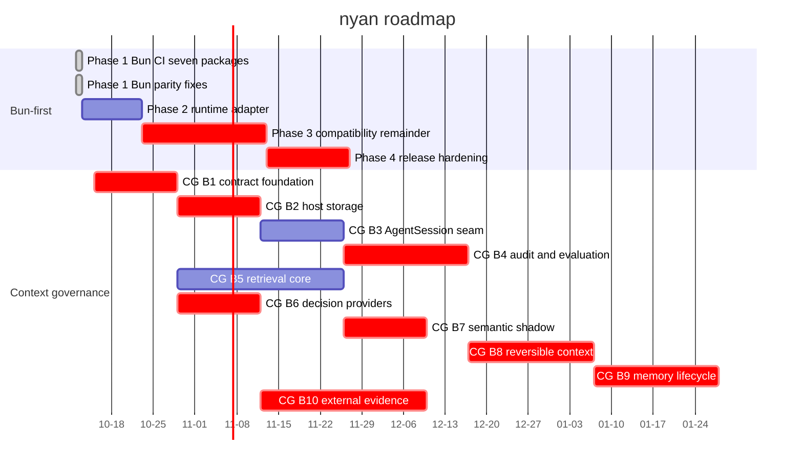

# Roadmap

Planned work and its status. Updated in the PR that changes it.

Last updated: 2026-10-14

WIP rule: No more than two roadmap lines may be active simultaneously.

This roadmap is the single source of truth for planned work and status. Future dates are estimates, not delivery commitments. A task is not considered done merely because source code, a design, or an external Pactile asset exists; its status requires verified Nyan repository or GitHub evidence. Owner recommendations below are planning assumptions, not owner decisions.

## Timeline

The Queue table records complete multi-parent dependencies where the compact Gantt representation uses one primary predecessor. Critical bars identify work waiting on an owner decision or on a task blocked by one. GitHub's current Mermaid renderer keeps the today marker on by default but rejects an explicit `todayMarker on` directive and its style form for this chart; the valid chart therefore relies on that default.

The verified baseline is `origin/main` at `82e63a1e` after merged PR #16. The Nyan tree still has 12 packages and has no `packages/context`, `packages/retrieval`, `packages/decision`, or `packages/coding-agent/src/core/context-governance` implementation. Pactile's source, tests, design documents, evidence fixtures, and the external retrieval worker are available as migration inputs, not as Nyan completion evidence. No implementation line is active after the roadmap merge.

### Status key

| Status | Meaning |
| --- | --- |
| Done | Implemented or formally published in Nyan and supported by repository or GitHub evidence |
| Partial | A related Nyan slice exists, but the requested item is not complete |
| Queued | No Nyan implementation has started; it is scheduled in the Queue |
| Blocked | Queued work cannot cross an owner decision, permission, evidence, or readiness gate |
| Reference | Design, source, test, or evaluation material exists outside Nyan and still needs a governed port |
| Out of scope | Explicitly excluded from this roadmap |

### Item assessment

The following assessment covers every numbered item from the handoff. A source file, test, design note, or successful probe in Pactile is not counted as a Nyan implementation.

#### Bun-first assessment

| Item | Status | Judgement and destination |
| --- | --- | --- |
| Phase 1 CI and parity | Done | PR #10 added seven-package Bun CI; PRs #12, #13, and #14 covered the remaining package and HTTP differences. |
| Phase 2 runtime adapter | Queued | `isBunBinary` and `process.versions.bun` checks remain scattered; no dedicated adapter, layer registration, or design note exists. Queue as Bun Phase 2. |
| Phase 3 HTTP, WebSocket, SQLite, subprocess, and worker work | Partial | Bun native fetch and idle-timeout behavior are implemented by PR #13, and WebSocket-related parity fixes are merged. A unified adapter, SQLite evaluation, source-loader, subprocess, worker, and complete cross-runtime validation remain. Queue as Bun Phase 3. |
| Phase 4 size, startup, signing, and install guidance | Partial | Standalone Bun binaries are released by PR #7 and release attestation is present through PR #15. Size/startup benchmarks, signing certificate scope, and provider-independent install documentation remain. Queue as Bun Phase 4. |

#### Compression and context pipeline assessment

| Item | Status | Judgement and destination |
| --- | --- | --- |
| C1 | Queued | Cut points, snapshots, deltas, and fingerprints are only in Pactile. Port to `@ny4n/context` in CG B1. |
| C2 | Queued | Context surgery policy is only in Pactile. Port to CG B1. |
| C3 | Queued | The Pactile pipeline is not connected to Nyan `AgentSession`; rewrite and split ownership across CG B3 and CG B8. |
| C4 | Queued | Nyan has existing compaction code, but not the Pactile deterministic governance summarizer. Port and test in CG B1 and B8. |
| C5 | Queued | No governed Nyan context pipeline exists. Rewrite for `AgentSession` in CG B3. |
| C6 | Queued | Threshold policy and admission gate are not in Nyan. Port to CG B1. |
| C7 | Queued | Review interaction and `/context review` are not in Nyan. Implement after the host seam in CG B4. |
| C8 | Queued | Immutable approval grants are not in Nyan. Implement in CG B4. |
| C9 | Queued | CDR/CAR validation is not in Nyan. Port the checks to CG B1 and verify in CG B4. |
| C10 | Queued | Receipt producers and persistence are not in Nyan. Implement in CG B3 and verify in CG B4. |
| C11 | Queued | Artifact intents, artifacts, and cross-run reconciliation are not in Nyan. Implement in CG B3 and CG B4. |
| C12 | Queued | The 17-item post-compaction audit is not implemented; CAR assurance is not evidence. Implement in CG B4. |
| C13 | Queued | ContextUnitManifest, anchors, and protection rules are not implemented. Implement in CG B8. |
| C14 | Queued | The eight actions are not implemented. Reversible actions belong in CG B8; lossy compression and drop remain separately authorized in CG B9. |
| G1 | Queued | No CG Coordinator or Workspace Host is attached to `AgentSession`. Implement in CG B3. |
| G2 | Queued | No ContextUnitizer exists for transcript, retrieval pack, or artifact inputs. Implement in CG B8. |
| G3 | Queued | No Compression Controller exists. Implement in CG B8 and keep it proposal-only. |
| G4 | Queued | No deterministic allow, deny, or review gate exists. Implement in CG B4. |
| G5 | Queued | Recovery, expansion, blocking, supersession, and regression cases are absent. Implement in CG B4. |
| G7 | Queued | No isolated evaluation controller exists. Implement in CG B4 without writing product state. |

#### Memory, host, and agent seam assessment

| Item | Status | Judgement and destination |
| --- | --- | --- |
| M1 | Queued | Fact schema, safety scanning, durability, recovery, and authorization are only in Pactile. Port and split in CG B1 and B3. |
| M2 | Queued | The Pactile ArtifactStore is not in Nyan. Port its contract in CG B1 and its filesystem host in CG B2. |
| M3 | Queued | Nyan scope must use git root or cwd rather than Pactile workspace scope. Decide the cross-session location before CG B9. |
| M4 | Queued | No Nyan `memory_read` ToolDefinition or renderer exists. Implement in CG B3. |
| M5 | Queued | Host memory ports are not in Nyan and have no RunLedger owner. Implement in CG B2 and B3. |
| M6 | Blocked | Memory promotion is not implemented and requires the approval carrier in Owner Decision #11. Queue in CG B9. |
| M7 | Queued | No `/memory` view and delete flow exists. Implement in CG B9. |
| G8 | Blocked | Retention and cleanup policy was open in Pactile and still has no Nyan policy. Decide and implement in CG B9. |
| H1 | Blocked | No Nyan RunLedger exists. The implementation choice is Owner Decision #10; queue the coding-agent host port in CG B2. |
| H2 | Queued | Tool effect intents and receipts are not in Nyan. Implement in CG B2 and connect in CG B3. |
| H3 | Blocked | No Nyan SQLite RuntimeStore exists. It depends on the RunLedger decision and belongs in CG B2. |
| H4 | Queued | No content-addressed filesystem ArtifactStore exists in Nyan. Implement in CG B2. |
| H5 | Queued | Pactile path, case-fold, and NFC utilities are not in Nyan. Reconcile with existing path utilities in CG B1 and B2. |
| H6 | Queued | No governed run-session composition root exists in the product path. Rewrite for `AgentSession` in CG B3. |
| H7 | Queued | No governed checkpoint entry exists in Nyan JSONL sessions. Implement in CG B3. |
| H8 | Queued | Pactile validation and fingerprint helpers are not in Nyan. Port to CG B1. |
| Kernel settlement projector | Out of scope | Product Kernel and settlement projection are not part of the requested Nyan roadmap. |
| P1 | Queued | `context_update` is not in the Nyan agent package. Add it only with the required ownership note in CG B3. |
| P2 | Queued | The undefined tool-result field omission is not verified in Nyan. Add the narrow agent-core seam in CG B3. |
| P3 | Queued | Pactile's native-agent wrapper must not be copied as an adapter. Attach the needed lifecycle hooks directly to `AgentSession` in CG B3. |
| P4 | Out of scope | Pactile provider-port and Pi adapter layers are unnecessary because Nyan already owns `@ny4n/ai`. |

#### Retrieval and decision-provider assessment

| Item | Status | Judgement and destination |
| --- | --- | --- |
| R1 | Reference | The zero-dependency worker exists only in `D:\MyHarness\pactile`; it is not an Nyan package. Port after the layer decision in CG B5. |
| R2 | Reference | Worker tests exist externally and are not Nyan evidence. Port selected parity tests in CG B5. |
| R3 | Reference | Retrieval ABI V3 files exist only in Pactile. Port contracts and planner in CG B5. |
| R4 | Queued | No Nyan local-worker process adapter exists. Implement Node and Bun paths in CG B5. |
| R5 | Queued | No Nyan agent retrieval boundary exists. Implement in CG B5. |
| R6 | Queued | No Nyan retrieval router, ranking, classification, or telemetry integration exists. Implement in CG B5. |
| R7 | Queued | `code_search` is not a Nyan tool. Implement in CG B5. |
| R8 | Blocked | EmbeddingGemma semantic retrieval has design material but no Nyan provider, index, chunker, or verified dimensions. Owner Decision #4 blocks readiness and test configuration; implement in CG B7. |
| R9 | Blocked | Index writes through EffectGateway versus an external index directory are undecided. Add Owner Decision #14 before production index writes in CG B5. |
| R10 | Queued | External Search, Fetch, and Evidence have design material but no Nyan implementation. Queue in CG B10. |
| R11 | Queued | No Retrieval Controller with branch budgets, deadlines, and cancellation exists. Implement in CG B5. |
| R12 | Queued | Lexical and relation branches are not in Nyan. Implement deterministic branches in CG B5. |
| R13 | Queued | Canonical locator, generation fences, merged IDs, and explicit RRF ordering are not in Nyan. Implement in CG B5. |
| R14 | Queued | Coverage, abstain, insufficient coverage, degraded, and blocked pack states are not in Nyan. Implement in CG B5. |
| R15 | Blocked | Retrieval capability and egress gates are not in Nyan. Owner Decisions #7 and #8 block external admission; queue in CG B10. |
| R16 | Blocked | No Search Provider is configured or built into Nyan. Provider and key must be owner-supplied; queue in CG B10. |
| R17 | Queued | No SSRF-safe Fetch adapter exists in Nyan. Implement host allowlists, HTTPS, redirects, limits, cancellation, and Artifact storage in CG B10. |
| R18 | Queued | No response-hash-based EvidenceRecord or citation pointer exists. Implement in CG B10. |
| R19 | Queued | No `web_search` or `web_fetch` tool exists. Implement only after external admission and evidence rules in CG B10. |
| R20 | Queued | Retrieval is not attached to Context Operation epochs or restart recovery. Integrate in CG B3, B5, and B10. |
| R21 | Queued | No external-link security fixture suite exists in Nyan. Implement in CG B10. |
| G6 | Queued | Inspect, freshness, generation, scope, revision, and hash fencing are not in Nyan. Implement in CG B5. |
| J1 | Blocked | Jev transport and outbound validation are not in Nyan; the Pactile hard-coded endpoint cannot be copied. Owner configuration is required in CG B6. |
| J2 | Queued | Rule provider and registry fallback are not in Nyan. Implement in CG B6. |
| J3 | Queued | Provider policy caps, assurance, and readiness are not in Nyan. Implement in CG B6. |
| J4 | Queued | The two Pactile Jev clients are not in Nyan and must be consolidated into one client. Implement in CG B6. |
| J5 | Blocked | Retrieval and compression shadow suggestions are not implemented. Owner Decision #4 blocks real provider readiness; queue retrieval shadow in CG B7 and compression shadow in CG B8. |
| J6 | Out of scope | Kernel scheduler, tile, task, and verification Jev integrations are excluded; only retrieval planning remains relevant. |

#### Test, evaluation, and evidence assessment

| Item | Status | Judgement and destination |
| --- | --- | --- |
| T1 | Reference | Pactile contract and durability tests exist externally. Port deterministic contract coverage to CG B1. |
| T2 | Reference | Pactile agent integration tests exist externally. Port applicable tests to CG B3 and B8. |
| T3 | Reference | Pactile runtime tests exist externally. Port host and recovery coverage to CG B2, B3, and B4. |
| T4 | Reference | Pactile retrieval tests exist externally. Port worker, planner, pack, and adapter coverage to CG B5. |
| T5 | Reference | Pactile Jev and provider-probe tests exist externally. Port safe readiness and schema tests to CG B6. |
| T6 | Out of scope | Kernel, old Pi executor/RPC host, and settlement-outbox tests are excluded. |
| E1 | Reference | P1a fixtures and frozen receipts exist in Pactile but are not in Nyan. Port as evaluation-only fixtures in CG B4; do not copy internal addresses. |
| E2 | Reference | P0 fixtures and review records exist in Pactile but are not Nyan product evidence. Port only the agreed evaluation assets in CG B4. |
| E3 | Blocked | The readiness probe exists but contains a tailnet address and cannot enter Nyan. Rewrite as configuration-only readiness checks after Owner Decision #4. |
| E4 | Blocked | The stage 1a runner was not found in the inspected sources. Owner Decision #5 is required before claiming runner parity. |
| E5 | Queued | Paired runs, FI-01 to FI-27, crash, replay, and unknown-outcome tests are new Nyan work in CG B4 through B10. |

#### Design and reference assessment

| Item | Status | Judgement and destination |
| --- | --- | --- |
| D1 | Reference | Compression decision chain and audit design; rewrite as an English Nyan spec for CG B1, B4, and B8. |
| D2 | Reference | ContextUnitManifest and protection rules; rewrite for CG B8. |
| D3 | Reference | Compression and memory evaluation matrix; use as CG B4 acceptance criteria. |
| D4 | Reference | Legacy migration rules are reference only because Nyan has no Pactile legacy session data. |
| D5 | Reference | Rebase and blocker history is evidence context, not an implementation. |
| D6 | Reference | Shared contracts, ownership, writeset, rollback, and stage plan govern all CG batches. |
| D7 | Reference | Retrieval provider, privacy, evidence, readiness, and evaluation designs govern CG B5 through B10. |
| D8 | Reference | Pactile agent prompts should become Nyan workflows only when the corresponding entry point exists. |
| D9 | Reference | Dual-product and host-track architecture is a design input; do not create a Pi adapter layer. |
| D10 | Reference | Retrieval bounded-context rules belong in the `@ny4n/retrieval` contract and tests. |
| D11 | Reference | Worker migration and native-agent gap designs guide CG B3 and B5. |
| D12 | Reference | Pactile implemented decisions must be re-expressed as Nyan notes and verified again. |
| D13 | Reference | Capability, privacy, provider, and workspace-request docs become Nyan user docs only after implementation. |
| D14 | Reference | Retrieval Search Service design is the architecture for CG B5 and B10, not current Nyan behavior. |
| D15 | Reference | Pactile module catalog is an inventory and status source, not proof of Nyan integration. |

### Acceptance invariant assessment

| Invariants | Judgement and acceptance destination |
| --- | --- |
| 1-5 | First-class failure states, disclosure, no replay of unknown effects, artifact-receipt-manifest ordering, and reversible protection are not implemented in Nyan. Gate CG B1 through B4. |
| 6 | Jev and embedding must remain advisory and fail-closed. Gate CG B6 through B8. |
| 7 | Retrieval candidates must be separated from independently verified evidence. Gate CG B5 and B10. |
| 8 | Egress is denied by default and requires capability and authorization snapshots. Gate CG B6 and B10. |
| 9-10 | Structured memory, logical references, and user-only deterministic summaries are not implemented. Gate CG B1, B3, and B9. |
| 11-12 | Evaluation/product isolation and separate authorization for lossy actions, promotion, drop, and egress are not implemented. Gate CG B4, B8, B9, and B10. |
| 13-14 | Abstain coverage, independent budgets, deadlines, and distinct cancellation/timeout outcomes are not implemented. Gate CG B5, B7, and B10. |
| 15 | Jev planning egress must remain separate from external search egress. Gate CG B6 and B10. |
| 16-17 | Search candidates, citations, stale evidence, SSRF, redirect, size, timeout, and cancellation rules are not implemented. Gate CG B10. |
| 18 | Source existence, integration, invocation, and verification must remain separate status claims. Apply this rule to every assessment above. |
| 19 | Retrieval, compression, evaluation, and rendering ownership boundaries are not implemented. Gate CG B3, B4, B5, and B8. |

## Active

No implementation line is active in the verified baseline. This roadmap update is documentation-only. The owner may select at most two lines from the Queue; reversible preparation may continue without crossing an owner-controlled gate.

| Line | Item | Owner | Branch / PR | Next step |
| --- | --- | --- | --- | --- |
| — | No implementation line is active | Blxze | This roadmap update | Select the next line without exceeding WIP 2 |

## Queue

| Order | Line | Item | Depends on |
| --- | --- | --- | --- |
| 1 | Bun-first | Phase 2 runtime adapter | Bun Phase 1 parity fixes |
| 2 | Context governance | CG Batch 1 contracts and layers | Owner Decisions #2, #3, #6; reversible preparation only |
| 3 | Bun-first | Phase 3 compatibility remainder | Bun Phase 2; Owner Decision #12 remains open despite the PR #13 implementation slice |
| 4 | Context governance | CG Batch 2 RunLedger SQLite and artifacts | CG B1; Owner Decision #10 |
| 5 | Context governance | CG Batch 3 AgentSession integration | CG B2 |
| 6 | Context governance | CG Batch 4 review audit and evaluation | CG B3; Owner Decision #5 |
| 7 | Context governance | CG Batch 5 deterministic retrieval | CG B1; Owner Decision #14; may run technically in parallel with B2 to B4 |
| 8 | Context governance | CG Batch 6 Jev and provider readiness | CG B1; Owner Decision #4 |
| 9 | Context governance | CG Batch 7 embedding and retrieval shadow | CG B5 and B6; Owner Decision #4 |
| 10 | Context governance | CG Batch 8 manifest and reversible actions | CG B4 and B6 |
| 11 | Context governance | CG Batch 9 memory promotion and retention | CG B8; Owner Decisions #1 and #11 |
| 12 | Context governance | CG Batch 10 external search and evidence | CG B2, B5, and B6; Owner Decisions #7, #8, and #14 |
| 13 | Bun-first | Phase 4 release hardening | Bun Phase 3; Owner Decision #13 |

## Decisions waiting on the owner

Do not close or reinterpret these entries without an owner decision. Work may continue on reversible preparation using the recommendation, but no approval gate may be crossed on that basis. Decision #12 has a merged implementation slice in PR #13, but the roadmap keeps the policy question visible until the owner explicitly closes it.

| # | Question | Recommended | Blocks |
| --- | --- | --- | --- |
| 1 | Cross-session memory location | `~/.nyan/agent/memory/` | CG B9 |
| 2 | Develop context governance only in nyan from now on | Yes | CG B1 |
| 3 | Keep Pactile review gates or use Nyan tests and notes | Tests + notes, keep evaluation fixtures and zero-tolerance rules | CG B1 |
| 4 | Jev and embedding endpoint config names and test credentials | Owner provides | CG B6 and B7 |
| 5 | Location of the Pactile stage 1a evaluation runner | Owner to point at it | CG B4 |
| 6 | Separate `@ny4n/decision` package or merge into `@ny4n/context` | Separate | CG B1 |
| 7 | External search open questions including URL canonicalization, retention, refetch, budget, schema, and allowlist | See the original checklist item 7 | CG B10 |
| 8 | External search provider and egress approval mode | Owner provides key; per-session approval | CG B10 |
| 9 | Bring Pactile non-context modules including Kernel, tasks, tiles, and app | Not now | None |
| 10 | RunLedger as a port of Pactile SQLite ledger or on `@ny4n/durable` | Port to the coding-agent host | CG B2 |
| 11 | Approver for memory promotion and lossy compaction without a Kernel | Explicit user confirmation stored as an immutable session entry | CG B9 |
| 12 | Bun HTTP dispatcher, keep undici or switch to Bun-native fetch | Bun-native fetch behind the runtime adapter; PR #13 is only a partial implementation slice | Bun Phase 3 remainder |
| 13 | Bun release signing certificate and key scope | Owner provides a certificate or explicitly defers signing | Bun Phase 4 |
| 14 | Retrieval index writes through EffectGateway or an external index directory | Freeze the port and recovery contract before choosing the storage placement | CG B5 and B10 |
| 15 | Keep the `V1` suffix in public contract names | Freeze one naming rule before public package exports are created | CG B1, B5, and B6 |
| 16 | Keep Pactile documents as an appendix or link-only reference | Rewrite verified Nyan behavior in English and link to Pactile design references | Documentation for CG B1 through B10 |

## Done

Only merged or formally published milestones verified from GitHub metadata are listed here. Pactile source and design assets are deliberately not listed as Nyan done items.

| Date | Item | PR |
| --- | --- | --- |
| 2026-10-11 | Repository governance foundation | [PR #1](https://github.com/blxzer77/nyan/pull/1) |
| 2026-10-12 | Standalone Bun release binaries | [PR #7](https://github.com/blxzer77/nyan/pull/7) |
| 2026-10-12 | Nyan 1.1.0 release | [nyan-v1.1.0 release](https://github.com/blxzer77/nyan/releases/tag/nyan-v1.1.0) |
| 2026-10-12 | Bun CI for seven packages | [PR #10](https://github.com/blxzer77/nyan/pull/10) |
| 2026-10-12 | Bun parity fixes and runtime fetch path | [PR #12](https://github.com/blxzer77/nyan/pull/12), [PR #13](https://github.com/blxzer77/nyan/pull/13), [PR #14](https://github.com/blxzer77/nyan/pull/14) |
| 2026-10-12 | Nyan 1.2.0 release | [nyan-v1.2.0 release](https://github.com/blxzer77/nyan/releases/tag/nyan-v1.2.0) |
| 2026-10-13 | Release attestation and Nyan identity refresh | [PR #15](https://github.com/blxzer77/nyan/pull/15) |
| 2026-10-13 | Roadmap governance and fact ownership | [PR #16](https://github.com/blxzer77/nyan/pull/16) |
