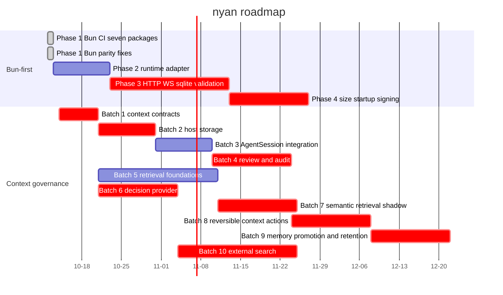

# Roadmap

Planned work and its status. Updated in the PR that changes it.

Last updated: 2026-10-13

WIP rule: No more than two roadmap lines may be active simultaneously.

This roadmap is the single source of truth for planned work and status. Future dates are estimates, not delivery commitments. A task is not considered done merely because source code or a design exists; its status requires verified repository or GitHub evidence. Owner recommendations below are planning assumptions, not owner decisions.

## Timeline

The Queue table records the complete multi-parent dependencies for tasks whose compact Gantt representation uses one primary predecessor. Critical bars identify work waiting on an owner decision or on a task blocked by one.

GitHub's current Mermaid renderer keeps the today marker on by default, but rejects an explicit `todayMarker on` directive and its style form for this chart. The valid chart therefore relies on that default rather than a parser-breaking directive.

The verified baseline is `origin/main` at `d539390f` plus GitHub PR and release metadata checked on 2026-10-13. PR #10 added the seven-package Bun CI line; PRs #12, #13, and #14 resolved the remaining Bun package and HTTP differences, and the latest GitHub CI run passed all jobs including the Bun job. A local all-package Bun run was attempted with Bun 1.4.3, but its durable suite remained unverified because Windows reported `EBUSY` while removing temporary SQLite directories; this does not replace the passing GitHub CI evidence.

## Active

No implementation line is active in the verified baseline. The roadmap PR is documentation-only. The owner may select the next reversible line from the Queue while keeping the WIP limit at two lines.

| Line | Item | Owner | Branch / PR | Next step |
| --- | --- | --- | --- | --- |
| — | No implementation line is active | Blxze | This roadmap PR | Select the next line without exceeding WIP 2 |

## Queue

| Order | Line | Item | Depends on |
| --- | --- | --- | --- |
| 1 | Bun-first | Phase 2 runtime adapter | Bun Phase 1 parity fixes |
| 2 | Context governance | Batch 1 layers and context contracts | Owner Decisions #2, #3, and #6; reversible preparation may proceed |
| 3 | Bun-first | Phase 3 HTTP WS sqlite validation | Bun Phase 2; Owner Decision #12 |
| 4 | Context governance | Batch 2 host RunLedger SQLite and artifacts | CG Batch 1; Owner Decision #10 |
| 5 | Context governance | Batch 3 AgentSession integration and memory read | CG Batch 2 |
| 6 | Context governance | Batch 4 review Policy Gate audit and evaluation | CG Batch 3; Owner Decision #5 |
| 7 | Context governance | Batch 5 retrieval foundations and code search | CG Batch 1; may proceed technically in parallel with Batches 2 to 4 |
| 8 | Context governance | Batch 6 decision provider readiness and shadow | CG Batch 1; Owner Decision #4 |
| 9 | Context governance | Batch 7 embedding and Jev retrieval shadow | CG Batches 5 and 6; Owner Decision #4 |
| 10 | Context governance | Batch 8 manifest and reversible actions | CG Batches 4 and 6 |
| 11 | Context governance | Batch 9 lossy compaction memory promotion and retention | CG Batch 8; Owner Decisions #1 and #11 |
| 12 | Context governance | Batch 10 external search and evidence | CG Batches 2, 5, and 6; Owner Decisions #7 and #8 |
| 13 | Bun-first | Phase 4 binary size startup and signing | Bun Phase 3; Owner Decision #13 |

## Decisions waiting on the owner

Do not close or reinterpret these entries without an owner decision. Work may continue on reversible preparation using the recommendation, but no approval gate may be crossed on that basis.

| # | Question | Recommended | Blocks |
| --- | --- | --- | --- |
| 1 | Cross-session memory location | `~/.nyan/agent/memory/` | CG Batch 9 |
| 2 | Develop context governance only in nyan from now on | Yes | CG Batch 1 |
| 3 | Keep Pactile review gates or use nyan tests and notes | Tests + notes, keep evaluation fixtures and zero-tolerance rules | CG Batch 1 |
| 4 | Jev and embedding endpoint config names and test credentials | Owner provides | CG Batches 6 and 7 |
| 5 | Location of the Pactile stage 1a evaluation runner | Owner to point at it | CG Batch 4 |
| 6 | Separate `@ny4n/decision` package or merge into `@ny4n/context` | Separate | CG Batch 1 |
| 7 | External search open questions including URL canonicalization, retention, refetch, budget, schema, and allowlist | See checklist section 12 item 7 | CG Batch 10 |
| 8 | External search provider and egress approval mode | Owner provides key; per-session approval | CG Batch 10 |
| 9 | Bring Pactile non-context modules including Kernel, tasks, tiles, and app | Not now | None |
| 10 | RunLedger as a port of Pactile SQLite ledger or on `@ny4n/durable` | Port to the coding-agent host | CG Batch 2 |
| 11 | Approver for memory promotion and lossy compaction without a Kernel | Explicit user confirmation stored as an immutable session entry | CG Batch 9 |
| 12 | Bun HTTP dispatcher, keep undici or switch to Bun-native fetch | Bun-native fetch behind the runtime adapter | Bun Phase 3 |
| 13 | Bun release signing certificate and key scope | Owner provides a certificate or explicitly defers signing | Bun Phase 4 |

## Done

Only merged or formally published milestones verified from GitHub metadata are listed here.

| Date | Item | PR |
| --- | --- | --- |
| 2026-10-11 | Repository governance foundation | [PR #1](https://github.com/blxzer77/nyan/pull/1) |
| 2026-10-12 | Standalone Bun release binaries | [PR #7](https://github.com/blxzer77/nyan/pull/7) |
| 2026-10-12 | Nyan 1.1.0 release | [nyan-v1.1.0 release](https://github.com/blxzer77/nyan/releases/tag/nyan-v1.1.0) |
| 2026-10-12 | Bun CI for seven packages | [PR #10](https://github.com/blxzer77/nyan/pull/10) |
| 2026-10-12 | Bun parity fixes and runtime fetch path | [PR #12](https://github.com/blxzer77/nyan/pull/12), [PR #13](https://github.com/blxzer77/nyan/pull/13), [PR #14](https://github.com/blxzer77/nyan/pull/14) |
| 2026-10-12 | Nyan 1.2.0 release | [nyan-v1.2.0 release](https://github.com/blxzer77/nyan/releases/tag/nyan-v1.2.0) |
| 2026-10-13 | Release attestation and Nyan identity refresh | [PR #15](https://github.com/blxzer77/nyan/pull/15) |
